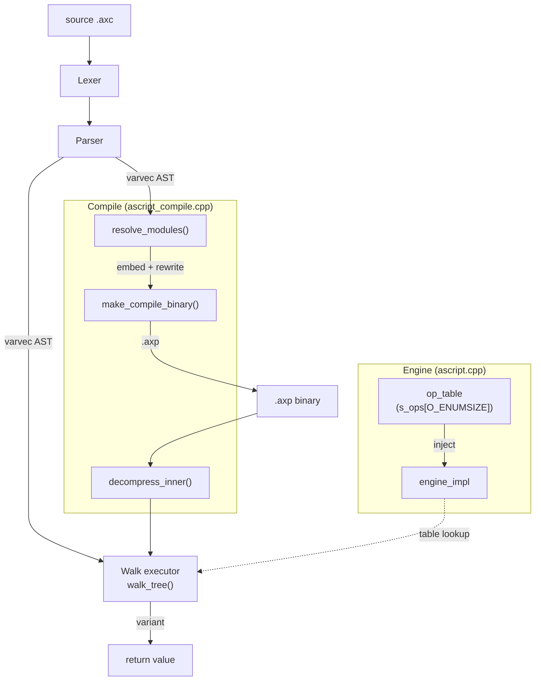

# Alexis Script — Design

## Design principles

> **Design red line: the script layer must not crash the engine.** Any script input (including deliberately hostile input) may at most raise `script_exception`; the engine process must survive. Exposing raw pointers, unchecked bounds, and uncaught exceptions all violate this. Linking a native library is not covered by this rule (it cannot be kept in check, and is not), so its crash is not the engine's responsibility.

| Principle | Description |
|------|------|
| **Permanent value semantics** | The script engine does not expose C++ raw pointers to the script layer. foreach reference semantics were evaluated and reverted (`ref_map` → SIGSEGV → unrecoverable). All variable access, argument passing and iteration are value copies. **Exception**: fwrap arguments are pointer-held for the link layer (C++) (`variant&` writable view); the argument semantics the script layer sees are unchanged (evaluated by value, bound by value); raw pointers are exposed only to the link layer, carrying an invalidation contract |
| **An exception must not crash the host** | `script_exception` is not re-thrown to the host. The shared entry ladder (`walker::run_entry`) does trace + `on_cerr` + return; a failure ends that run only — the engine state stays, and `reset()` is explicit |
| **Defensive bounds checks** | Array out of bounds → `IndexError`, missing map key → `KeyError`, type mismatch → `TypeError`. No silent null return |
| **Link libraries are out of control** | Crashes and memory safety of native C++ code (`.so`/`.dll`) are not the engine's responsibility |

### Visibility, ownership and capability

> The same red line as one sentence: **a child call may change content, never the slot.** A module and a frame are both layers; a slot belongs to the layer that declared it.

| Layer | Owner | Who may touch it |
|---|---|---|
| slot (the name binding) | the layer that declared it | only that layer removes it — a frame deleting an outer name gets `false`, an alias it did not create is not its to release |
| content (the value in that slot) | nobody | any layer writes it through; a child changing content is the normal case, not an accident to guard against |
| resource (the instance behind a link/import handle) | nobody — it is **refcounted** | whoever holds a reference, and the last holder decides its death. A copy is an independent instance holding its own reference, so replacing an alias's content in a child drops that slot's reference only |

- **Shadowing is resolution priority, not deletion.** A child declaring a same-named object hides the parent's from unqualified resolution; the parent never becomes unreachable. `.` / `..` / `::` name the entity explicitly, and for a chain's **terminal key** they resolve in that entity's table only — intermediate segments still walk the running activation's definition chain first (which is why `.m.k` finds the frame's `m`). Calls obey the same rule, and that is exactly what an unqualified `g()` does not do.
- **Derived bindings are capabilities.** func and area live inside their owner's store and are not values: no copy (`function cannot be read as a value`, `link area cannot be copied`), no read as a value, and no delete from another layer. A child that wants an outer function out of the way **declares its own** — hiding is always positive (a new binding), never negative (a tombstone).
- **A qualified call reaches only its entity.** When the name exists only in the caller's frame the call is a `TypeError` that says so (“… is a frame local, call it unqualified”) instead of an “undefined function”: the error anchor is part of the rule, not a nicety.

### The dot chain returns an address

The script has copy semantics only; a chain that materialised intermediate values would make every write into a container cost that container. `resolve_dot` therefore hands back a `variant*` plus the entity/link context, and read, write, delete and call all consume that one resolution — the reflective `@()` path included, so there is no second door. Measured: 2000 writes into a 50 000-entry map — 0.12 s through `m.a.b`, 10 m 23 s spelled as copy-in/copy-out.

`.(...)` is the **only** crossing from the entity graph into the value graph: it makes the located value's keys and elements reachable. It takes literals only and must be chain-terminal — not a taste in syntax: an expression inside it could run script code and invalidate the very address the chain just took. One crossing, at the tail, literal-only ⇒ the address cannot outlive its use.

### `@` is the pointer substitute

The language has no pointers, and its value semantics rule them out, while dot is a **static** chain over two graphs whose single crossing takes literals — neither can express “the name I want is computed at run time”. `@()` closes that gap: its argument is evaluated and parsed into an object alias at the moment of use, and the alias takes part in the same access surface as a written chain — read, write (`@("x") = 5`), indexed navigation (`@("m")["k"] = 2`), `delete @("x")`, and call (`@(fn)()`, `@(".." + name)()`).

It is a **one-shot dereference, not a pointer**: `var p = @("x")` copies the value, so `p` does not follow a later write to `x`. There is no way to store an address — only to name a slot at the moment it is used. That is the contract the design wants: indirection for data abstraction, with no address escaping into script values and no lifetime for the script to manage. The name is not checked until it is used, so a miss is a run-time `NameError`, not a compile error.

### One rule at one choke point

Failures are made loud and located where the decision is made, never patched per operation: `env` raises `ArgError` (argument count), `TypeError` (argument type) or `ConvError` (empty entry) and commits the replacement whole; `type` refuses a second argument before evaluating it; a chain that reaches a callable before its terminal key raises instead of calling the callable and dropping the rest. Silent drops count as violations of the “Defensive bounds checks” row above. Known remainder: the other one-value builtins (`vec`, `bool`) still ignore extra arguments — the fix belongs at the dispatch/arity choke point, not in each op.

---

## 1. Architecture overview



**Design decisions:**
- **Three-layer separation**: Engine (thin wrapper + state holder), Compile (pure data pipeline), Walk (runtime execution)
- **AST node types are enumerated**: `op_enum` (`uint_8`) is defined in `ascript_enum.h`, replacing the former `std::string` tag. The `varvec[0]` the parser produces changed from `variant(string)` to `variant(uint_8)`; the walker dispatches by O(1) indexing into the bare `op_func[O_ENUMSIZE]` array via `O_ENUMSIZE`
- **var_map promote cache**: once `var_ptr()` finds a variable in an outer frame it promotes it into the current frame's var_map, so later accesses hit in O(1) and the repeated cross-frame hash disappears
- **token_type de-classing**: `enum class token_type` → `enum tk_enum`; the former `T_BUILTIN_FUNC` is gone, split into separate tokens (`T_INT`/`T_FLOAT`/`T_STRING`/`T_BOOL`/`T_VEC`/`T_MAP`/`T_LST`/`T_TYPE`/`T_ENV`; `T_TOJS`/`T_FMJS`/`T_PRINT`/`T_INPUT` were removed along with their migration out to extension functions)
- **Unified data_store storage**: all data (variables / defs / native functions / sub-entities / link modules / areas) is stored in `data_store` (`vector<variant> m_data` + `unordered_map m_map` + `vector m_free`), exposing `find`/`store`/`remove`/`contain`. Script objects are accessed through `anyptr` (`call_able` unifies def/native, `link_area` holds the area object + natives). `fly_link` holds `data_store m_store` directly (the template data), and `fly_import` holds its template in `m_root` — an `impl_import` the init walk runs on directly, so a child imported during that walk binds its `m_parent` to a live object; `impl_fly_import` deep-copies the template from `fly->m_root.m_store` and re-points every cloned child (recursively) at the new instance. An instance holds a fly ref (`m_ref.ref()`) so that sharing among multiple instances cannot release it early. `mod_mng::release_fly` manages the fly lifetime passively
- **walker class encapsulation**: the `walker` class holds `walk_state state` + `mod_mng* mgr` + the static op dispatch table `s_ops`; every op function and helper is a walker static method, and `walk_tree()`/`walk_forest()` are walker member functions. The Engine holds a `mod_mng` + a `walker` and exposes functionality through the `engine` class and the `fwrap` interface
- `fwrap::bind(name, func[, area])` — register a native function: no area → `m_store.store(name, anyptr<call_able>)`; with area → create a link_area → store the native into area->m_natives; a name already bound answers false and the existing binding stays
- `fwrap::object()` — the C++ object currently bound to the area (`&m_area->m_object`)
- `fwrap::unwrap<T>()` — `anyptr_ex<T>::as(*object())`, null-guarded — type-safe unwrapping
- `fwrap::wrap<T>(ptr, area, methods)` — store the anyptr + bulk-register the area methods (creates an instance dynamically); false when the area name is empty or taken — the refusal happens before anything is stored; the method list is a `std::map`, so its names are unique by construction
- **Alias values**: an `import`/`link` `as` alias is an ordinary value — a bare read is a **copy** (an independent instance) and an assignment over it discards the instance for the value. Every hand-off — a call argument, a return, a container literal or element, `@("alias")` — copies the same way (value semantics). The copy's parent is its holder: every binding site stamps the slot it wrote (`bind_owner` from `store_raw` / `assign_raw` / `scope_frame::raw_store` / the slot branch of `op_store` and `store_slice`, whose `target_resolved::owner` names the slot's owner), so `..` from the copy resolves in the module that holds it; a copy that is never bound (a temporary, or one built into a container literal) has no parent. The copy is independent of the original — its own store, its own sub-module instances (the copy constructor re-binds its children to the copy), its own reference to the shared fly — so a later `delete` of the original does not touch it. link additionally shields dot writes (`alias.x = v` → `TypeError`) — a link's sub-data (everything reached *through* the link: areas, instances, data) is opaque however deep, the `op_dot` terminal read included; import allows dot writes (they write into the import entity's `m_store`). An area instance/namespace (a `link_area` handle) can be removed by the script with `delete` (the anyptr destructor destroys the host object); link/area functions (callable) and data variables (a handle stored into the data included) cannot be deleted → `TypeError`. The script can only reach link data operations indirectly, through functions the area registered
- `scope_frame` binds `impl_import*` by RAII: the constructor records `base` (`ent->m_store.m_data.size()`), the destructor resizes `ent->m_store.m_data` back to base. Exposes `find`/`store`/`remove`/`contain`
- `scope_frame::def` — `const varvec*` function definition pointer, used for call-stack tracing on an exception (the trace lazily builds an entity → def→name reverse mapping)
- Variable data lives in `data_store` (`m_data` + `m_map` + `m_free`), which gives O(1) resize rollback and zero-cost template copying
- `scope_frame::var_map` uses `size_t` absolute indices, indexing `ent->m_store.m_data` directly
- A module top level has no main frame — `var` writes straight into `impl_import::m_store` (`m_map` → `m_data`); frames are created only for function calls
- `walker::reset()` = `state.clear()` + set `state.root`/`state.current` (no frame push)
- `walker::walk_state_trace()` — builds the call-stack string from the frames left over globally
- `walker::init()` — idempotently initialises the static `s_ops` table; called automatically from the walker constructor
- `native_func` signature: `void (*)(fwrap&)` — fwrap provides args/freturn/load/store/bind
- **fwrap arguments are pointer-held**: an argument is pointer-held (a `variant&` writable view); the call scans its arguments into records first (`scan_call_args`: values evaluated in place, bare names deferred), takes the callee's address afterwards, and resolves the deferred names to their slots in one pass (`native_arg_ptrs`, the vector reserved once), zero-copy. **Contract**: reads and writes are safe until the first `fw.call()` back into script (after that they are invalidated or the contents may change, and must not be used again); a write to a variable argument is visible to the caller; an out-of-bounds access raises `IndexError`. **Call semantics**: one rule for the whole language, "read at the end" — the arguments are evaluated left to right (side-effect order unchanged), the callee's path expressions run after them, the address is taken last, and the value of a variable argument is read only after every argument has been evaluated (identical for natives and defs); nothing runs script code between the address being taken and the invoke
- `script_load / script_create / script_release / script_unload` — link `.so` entry points, `void (*)(fwrap&)`, all optional. load builds the template (once per fly) and create builds an instance; release runs when an instance is destroyed and unload when the fly's last reference is released
- Path resolution (runtime import/link): an absolute path is looked up directly → the current instance's env list in order (**before any `env()` call the list holds the module's own directory as an absolute path**, in force while env() has not been called; an `env(vec)`/`env(lst)` call replaces it; an explicit `env([])` empties it; `env()` with no argument returns the list as a `vec` and changes nothing) → the list the host set with `engine::set_search_paths` (engine search paths) → a fallback relative to the CWD (when CLI/cache mode has no script path)

---

## 2. File structure

```
include/alxscpt/ascript.h          — public API (engine + fwrap + script_exception + error_type)
source/alxscpt/
  ascript.cpp                      — thin engine wrapper (holds mod_mng + walker)
  script/
    ascript_enum.h                 — op_enum + tk_enum definitions
    ascript_base.h                 — base types (data_store, call_able, link_area, fly/impl, scope_frame, walk_state)
    ascript_utils.h                — type utilities (type_pair, eq_cmp, cov_*, type_name_script, switch dispatch)
    ascript_lex.{h,cpp}            — Lexer
    ascript_dot.{h,cpp}            — Dot chain resolution (resolve_dot / step / get)
    ascript_parse.{h,cpp}          — Parser
    ascript_compile.{h,cpp}        — Compile pipeline
    ascript_walk.{h,cpp}           — walker class (op dispatch + built-in functions + scope_frame)
    ascript_fwrap.{h,cpp}          — fwrap virtual class implementation
    ascript_modmng.{h,cpp}         — instance layer (per-engine fly pool + simplified gate)
    ascript_resmng.{h,cpp}         — resource layer (AST cache + link handle pool, the only multithreaded surface)
    ascript_trace.{h,cpp}          — call-stack trace compression (repeated-segment folding)
gtest/alxscpt/src/
  gt_ascript_lex.cpp               — Lexer tests
  gt_ascript_parse.cpp             — Parser tests
  gt_ascript_walk.cpp              — Walk tests
  gt_ascript_compile.cpp           — Compile pipeline tests
  gt_ascript_context.cpp           — fwrap/walker unit tests
  gt_ascript_debug.cpp             — debug positions: O_DEBUG markers, row/col of uncaught errors, debug hook events
  gt_ascript_pipe.cpp              — host IO pipe unit tests (set_pipe routing via fwrap)
  gt_ascript_trace.cpp             — call-stack trace compression tests (compress_trace / format_trace)
  gt_ascript_yield.cpp             — the yield service: queue, deliveries, nested yield, interrupt settlement
  gt_ascript_utils.cpp             — variant conversion / comparison / trace unit tests
  gt_ascript.cpp                   — Engine integration tests
doc/scpt/bench.md                  — performance benchmark
example/Scpt/                      — CLI + base.so
```

---

## 3. Syntax & AST

> **AST node types are stored as `op_enum` (`uint_8`).** `varvec[0]` is a `variant(uint_8)` (e.g. `O_IMPORT`). All 91 op_enum values are defined in `source/alxscpt/script/ascript_enum.h` (the compound assignments `O_ASS_*` are one opcode per operator, emitted directly by the compound-assignment parse path).

**Literals**: `"string"` (escaped byte string), `'c'` (char literal — exactly one Unicode code point, [#44]), `` `raw string` `` (no escapes, may span lines). The lexer emits `T_STRING_LITERAL` / `T_CHAR_LITERAL` / `T_BACKTICK_LITERAL`; the parser produces a `variant(string)` leaf node for the first and third, an ordinary `variant(int_64)` for the char literal.

### 3.1 Import / Link

```
import "module.axc" as name;     →  [O_IMPORT, "path", "alias"]
link "native" as name;        →  [O_LINK,   "path", "alias"]
env(paths);                      →  [O_ENV,    paths]     // set
env();                          →  [O_ENV]              // read back as a vec
```

`as NAME` is mandatory; missing = syntax error. `O_IMPORT`/`O_LINK` are allowed at top level only.

**Suffix guessing**: when an import/link path gives no suffix, the engine first looks it up without a suffix and only then guesses:
- `import "foo"` → first `foo`, then `foo.axp`, finally `foo.axc`
- `link "foo"` → first `foo`, then `foo.so` (Linux) / `foo.dll` (Windows) / `foo.dylib` (macOS)

**Cross-platform advice**: leave the platform-specific suffix (such as `.so`) out of a link path and let the engine guess it, which eases cross-platform deployment.

### 3.1b here — compile-time position constant

```
here() → [O_HERE, {row, col, ofst, file}]   // varmap literal, built during parse
```

- `T_HERE` token (reserved word, function form only; a bare use = syntax error)
- parse_primary intercepts it: the token's own row/col/ofst are taken and packed into a varmap stored in the node; every value is a script int
- `file` = the parsing context path (`file_info::path()`, i.e. `conver_std_path`): the file entry gives the source file's absolute path; with a directory context only (`exec(src, dir)`) it is the directory; with no context (REPL / byte execution) it is the empty string
- An engine file entry (`exec(file)`/`compile(path)`) hands the real source file path to the parser through `m_src_file` (an RAII guard), as distinct from the home_dir directory; an import module passes the module file path directly in `load_module_ast`
- The walker's `op_here` returns the node's map directly (no computation)
- Use: script-level assert / logging / custom exceptions carrying the call point's position (a compile-side debug primitive)

### 3.2 Chain access AST

**Unified dot chain model** — "dot chain" and "nav chain" are no longer distinguished. "`..`/`::`/`.`" are merely locating markers inside the chain; `.()` separates entity navigation from data access.

```
No prefix:   a.b.c[0]     → all access segments — climb frames for var a → value chain .b.c[0]
Prefixed:    ..a.b         → all locate segments — pure entity navigation; the tail names a member of that entity (a sub-entity, variable or function)
          ..a.b.(c.d)   → locate segment ..a.b, .(...) bridges, access segment c.d
          ::a.b.(c[0])  → locate segment ::a.b, bridge, index inlined as int_64
```

**A prefixed dot chain reaches members without a bridge** — the locate segment plus trailing keys resolves through the entity tree to a variable / function / element (link data stays opaque); `.(...)` is an optional terminal re-entry that starts a fresh chain from the located value, and the grammar does not require it.

**Name constraint (with computed-value cascades evaluated)**: an element in the middle of a dot chain must be **named** — a variable slot or a navigation token. A computed value (a temporary such as `f()`) does not enter `resolve_dot`: under value semantics a temporary has no persistent storage, and supporting it would need eval plus temporary-slot management (write path, aliasing, lifetime) — high complexity, low payoff, so it is refused by design. A computed value takes keys with `[]` (O_INDEX goes down the eval path, which supports it natively — step::field container navigation `f()["x"]["y"]` already covers the read path completely).

A dedicated evaluation of computed-value dot cascades (`f().x.y`): O_INDEX already covers it equivalently → pure syntactic sugar; the write/delete paths are semantically empty for a temporary (a temporary dies as soon as it is written, and the script has no reference semantics) → it should be a runtime TypeError. The one non-equivalent case = a named navigation whose chain head returns an entity (`get_mod().func()` — O_INDEX can only index a container, it cannot navigate an anyptr\<impl_import\>) — a function dynamically returning a module reference is rare, and opening a bridge for it is not worth it. The navigation-segment family as it stands: the locating kinds (a name / `..` parent / `::` root / `.` current module) plus the `.()` bridge as the only special case — the parse layer forces the bridge to be chain-terminal (the message in ascript_parse.cpp is `bridge .(...) requires a nav prefix (. .. ::)`; the postfix loop breaks after the bridge, so nothing can follow it), and a mid-chain call `a.b().x` is refused just the same.

At runtime `resolve_dot()` walks the chain: an OPTYPE marker drives the entity jump (O_PARENT/O_ROOT/O_CURRENT), while a string/int switches among the T_Variant/T_Slot/T_Callable states. After N-1 steps the terminal key is left in `dot_resolved::key` and the caller dispatches it itself. link/area data is completely shielded from the script (read/write/delete → TypeError); the shield sits on the resolved terminal — `dot_resolved::link_owner` marks a chain that entered a link's data — so an element or nested key is refused exactly like the link's own slot.

The parser flattens the whole chain into `[O_DOT, elem...]` — no `O_INDEX` sub-vector, no `O_BRIDGE` marker:

```
a.b.c                          → [O_DOT,  "a", "b", "c"]              // variable / namespace read
a.b[0]                         → [O_DOT,  "a", "b", 0]                // index inlined as int_64
a[0].b                         → [O_DOT,  "a", 0, "b"]                // mixed member + index
a.b[0][1]                      → [O_DOT,  "a", "b", 0, 1]             // consecutive indices
a[1].b.c[2][3]                 → [O_DOT,  "a", 1, "b", "c", 2, 3]     // anywhere in the chain

a.b(args)                      → [O_NCALL, ["a", "b"], args...]       // function call, parser spots ( directly
a.b = x                        → [O_STORE, [O_DOT, "a", "b"], x]      // assignment
```

**Standalone index** (no `.` prefix, keeps the 2-ary `O_INDEX` shape):

```
a[0]                           → [O_INDEX, [O_LOAD, "a"], [0]]       // standalone binary node
```

**Slice** (comma separated, new `O_SLICE` node):

```
a[1, 3]                        → [O_SLICE, [O_LOAD, "a"], 1, 3, 1]  // [from, to) left-closed right-open
a[0, 5, 2]                     → [O_SLICE, [O_LOAD, "a"], 0, 5, 2]  // step 2
a[2, null]                     → [O_SLICE, [O_LOAD, "a"], 2, null, 1] // null = size
```

- `O_SLICE(from, to, step)` — always 5 elements, `[from, to)` left-closed right-open
- a literal is stored as `int_64` directly, an expression as a `varvec`
- `null` → size, `-1` → size-1, out of bounds → IndexError
- step > 0: from ≤ to; step < 0: from ≥ to; step = 0 → ArgError
- the result is a new container of the same type (vec→vec, lst→lst, string→string, bytes→bytes); a slice is an operation, not an address — as an assignment target it scatters into the source (see #43)

**With a locating prefix** — `..` / `::` / `.` name the starting entity; the following keys locate level by level in the entity tree:

```
..x              → [O_DOT, O_PARENT, "x"]                // parent module variable
..(f)(args)      → [O_NCALL, [O_PARENT, "f"], args...]   // call a parent entity's function
....x            → [O_DOT, O_PARENT, O_PARENT, "x"]      // two levels up
::x              → [O_DOT, O_ROOT, "x"]                  // root entity variable
::a.b.(f)(args)  → [O_NCALL, [O_ROOT, "a", "b", "f"], args...]
.a.b             → [O_DOT, O_CURRENT, "a", "b"]          // the current entity, explicit

// .. inside a chain (sibling module lookup)
a..b             → [O_DOT, "a", O_PARENT, "b"]

// bridge .(...) — purely flat, no O_BRIDGE / O_INDEX marker
..a.b.c.(d.f)    → [O_DOT, O_PARENT, "a", "b", "c", "d", "f"]     // locate segment to an entity → enter the data chain
..a.b.c.([1])    → [O_DOT, O_PARENT, "a", "b", "c", 1]            // bridge index inlined
..a.b.c.(d) = 5  → [O_STORE, [O_DOT, O_PARENT, "a", "b", "c", "d"], 5]  // bridged assignment

// activation anchor (frame lookup, not entity navigation)
^x               → [O_DOT, O_ACT, "x"]              // the declaring activation's x
^^x              → [O_DOT, O_ACT, O_ACT, "x"]       // the grandparent activation
^a.b             → [O_DOT, O_ACT, "a", "b"]
^g(args)         → [O_NCALL, [O_ACT, "g"], args...]
```

**var declaration** (basic form — initialiser optional):

```
var x;                         → [O_VAR, "x", variant()]               // no init → a null placeholder
var x = 1;                     → [O_VAR, "x", [O_LOAD(1)]]             // with init
var a = 1, b, c = 3;           → [O_VAR, "a", [init...], "b", null, "c", [init...]]
```

**typed var sugar** (8 type keywords):

```
int a;                         → [O_VAR, "a", [0]]                     // no init → the type's default value
int a = 42;                    → [O_VAR, "a", [O_INT, 42]]             // with init → a conversion
float b = 3.14;                → [O_VAR, "b", [O_FLOAT, 3.14]]
string c = "hello";            → [O_VAR, "c", [O_STRING, "hello"]]
bool d = true;                 → [O_VAR, "d", [O_BOOL, true]]
bytes e;                       → [O_VAR, "e", [bytes()]]               // empty bytes
vec f;                         → [O_VAR, "f", [[]]]                     // empty vec
map g;                         → [O_VAR, "g", [map{}]]                  // empty map
lst h;                         → [O_VAR, "h", [[]]]                     // empty lst
```

**typed var in a for loop**:

```
for (int i = 0; i < 10; ++i) {}    // for-c: typed init
for (int i; i < 10; ++i) {}        // for-c: typed init, default 0
for (int x : arr) {}               // for-each: typed var, default 0
for (int i = 0, j = 1; ...) {}     // multi-decl: same type keyword
```

**desugar rules**:
- `int a;` → `var a = int()` (no init → the type's default value literal, wrapped in `[literal]` so `op_var`'s `is_vec()` check passes)
- `int a = expr;` → `var a = int(expr)` (with init → an `[O_INT, expr]` node)
- `type_default_value` returns the raw literal value and the call site wraps it with `varvec{value}` (`op_var` needs `is_vec()` before it will walk the init)

**Supported type keywords**: `int` / `float` / `string` / `bool` / `bytes` / `vec` / `map` / `lst`

**Indirect call** (function name evaluated at runtime):

```
@(expr)(args)                  → [O_ICALL,  expr, args...]             // expr evaluates → string → parse+walk
@a.b.c(args)                   → [O_ICALL,  [expr_a, expr_b, expr_c], args...]
```

**Tail recursion** (detected automatically by the parser):

```
return func_name(args)         → [O_TCALL, [O_LOAD, "func_name"], args...]  // a self tail call, no new frame
```

**Argument spread**:

```
f(vec_arg[])                   → f([O_UNPACK, [O_LOAD, "vec_arg"]])   // last argument only
```

A def call expands `O_UNPACK`; a native (`$` / link) call receives the container as one argument; anywhere else the marker reaches `op_unpack` and is a `TypeError` (`spread [] is not a value`), so a builtin such as `type(v[])` refuses instead of reading null.

**Constant folding** — a dot chain's `[]` accepts literals only. `-N` (unary minus + int literal) is constant-folded by the parser into an inlined negative integer and produces no `O_UMINUS` node:

```
a[-1]  →  lex: T_MINUS T_INT_LITERAL(1)  →  parse: O_UMINUS(1)  →  fold: int_64(-1)  →  [O_DOT, "a", -1]
```

**Constraints the parser enforces:**
- A locating prefix is only ever `.` / `..` / `::`, followed directly by `T_NAME` (no extra `.`). `..varName` is legal, `.. .varName` is not
- `^` is a fourth anchor of a different kind: it starts the *frame* lookup at the declaring activation, must be followed by `T_NAME` (one `O_ACT` per `^`; `^^x` stacks two), and never counts as a nav prefix for `.(...)`. The token is shared with bitwise XOR and read as an anchor only in operand position (`a ^ ^x` is XOR with an anchored right side)
- An `[]` index inside a chain must be a literal (integer / string / null); `-N` is constant-folded to a negative integer. A variable index `a[i]` is illegal in a dot chain — when something has to be computed dynamically, concatenate the path string with `+` and reach it by reflection with `@(path)`
- Inside a `.(...)` bridge, likewise only literal indices are accepted

`O_DOT` chain segment types (at runtime `resolve_dot()` dispatches its state machine by context):

| Element | Shape | Meaning |
|------|------|------|
| string | `"key"` | variable name / sub-entity key / link key / varmap key |
| int_64 | `0`, `-1` | container index (vec/lst/map numeric key), a bare value in the chain |
| null | `variant()` | append at the end of a vec/lst (index + push_back) |
| `O_CURRENT` | op_enum | `.` — lock onto the current module (no-op) |
| `O_PARENT` | op_enum | `..` — climb to the parent module |
| `O_ROOT` | op_enum | `::` — jump to the root module |
| `O_ACT` | op_enum | `^` — move the name lookup to the declaring frame of the enclosing callable |

`O_NCALL` lookup: `var_ptr` → call_able (def or native), resolve_dot → the link/area m_store. An area is one level only (`link.area.func`); an extra key is judged the area key followed by the func_name.

**Standalone control flow / definition AST (no optimisation):**

```
O_BLOCK:  [O_BLOCK,  stmt1, ...]
O_WHILE:  [O_WHILE,  test, body]
O_FOR:    [O_FOR,    init, test, update, body]
O_FOREACH: [O_FOREACH, target, iter, body]
O_DEF:    [O_DEF,    name, params, defaults_map, body]
```

### 3.2b Dot chain resolution (resolve_dot / TerminalKind / dot_resolved)

Dot chain resolution is implemented in `ascript_dot.{h,cpp}`; the core components:

#### TerminalKind enum (v2: 9→3)

3 values, naming the owner type the terminal key lives in (heavily trimmed once m_data became unified storage):

| Value | Meaning |
|----|------|
| `T_Variant` | an element inside a container (vec/varmap/varlst value) |
| `T_Slot` | m_data[idx] → dispatch on the variant's type (anyptr→entity/link/area, otherwise→the variable's value) |
| `T_Callable` | m_data[idx] → anyptr&lt;call_able&gt; (def or native) |

#### ParentKind enum

Assists `del_dot` dispatch. **`Map`/`Vec`/`Lst`/`Value` describe what `parent` itself is**; `Frame`/`Entity`/`Link`/`Area` are the **lookup-by-name** context — the terminal key is a name, not an index:

| Value | Terminal key | `parent` |
|----|---------|---------|
| `Unknown` | — | sentinel, should never reach `del_dot` |
| `Frame` / `Entity` | a name, resolved by name in the scope frame / entity m_store | non-null = the value that name resolved to (a callable slot, or a non-container value) → no deletable field; null = not yet resolved to a slot (a sub-entity and the like) |
| `Link` / `Area` | a name | `anyptr<impl_link>` / `anyptr<link_area>` |
| `Map` / `Vec` / `Lst` | an index | that container itself |
| `Value` | an index | a leaf value (string/scalar) — not indexable, not deletable |

> **`parent_kind` in the `T_Variant` branch is a safe cache of `parent`'s type**: `kind == T_Variant` ⟹ `parent` is non-null and not an anyptr (what `step::ent`'s fallback enforces, source/alxscpt/script/ascript_dot.cpp:88-93), so the type could be decided by `parent->is<T>()` directly. The three refining sites (the string key / vec index / lst index in `step::field`) must be exhaustive, with a leaf falling to `Value`, written uniformly by `set_parent_kind()`.
>
> The `else → pk` in `step::ent` (source/alxscpt/script/ascript_dot.cpp:93) **does not** fit that rule and must not be forced into it: there the terminal key is a name, and a scalar value goes down the `Frame`/`Entity` `if (r.parent)` branch, raising `Type does not support delete .<name>`; judging it `Value` instead would misreport it as `delete [i]`. The test `Delete_ScalarFieldViaDot` pins that difference.

#### dot_resolved structure (v2)

```cpp
struct dot_resolved {
    TerminalKind kind = TerminalKind::T_Slot;
    variant key;
    impl_import* slot_owner = nullptr; // entity that owns parent
    impl_link*   link_owner = nullptr; // link that owns parent

    variant*   parent = nullptr;                // container/slot that holds key
    ParentKind parent_kind = ParentKind::Unknown; // what kind of container parent points into

    bool is_callable() const;   // kind == T_Callable
    variant* get(bool _readonly = true) const;
};
```

- `resolve_dot(ast, state)` — navigates N-1 steps and leaves the terminal key in `r.key`. It tracks the entity/link context through `slot_owner`/`link_owner`. **It hands back an address, never a value** — that is the point of the whole chain: the script has copy semantics only, so a chain that copied would turn every write into copy-in/copy-out of the container. Measured (`bin/Scpt`): 2000 writes into a 50 000-entry map — in place through `m.a.b` 0.12 s, the same writes spelled `var t = m; t["a"] = j; m = t;` **10 m 23 s** (~5000×, each copy deep-copies the map)
- `get(_readonly)` — T_Slot/Callable returns `parent` directly (already pointing at m_data[idx]); with no parent it looks the key up through slot_owner
- `is_callable()` — `kind == T_Callable`
- `parent_kind` — `del_dot` dispatches on it: Frame/Entity→`m_store.remove`, Link→`m_store.remove`, Area→`m_natives.erase`, Map/Vec/Lst→container erase, Value→`TypeError`

#### resolve_dot — the N-1 navigation state machine

```
initial state: r.kind = T_Slot, r.slot_owner = state.current
walk dot_ast[1 .. size-2] (every element but the O_DOT head and the tail):
  dispatch on the current kind to one of step::*:
    step::ent   — entity context (T_Slot, slot_owner points at an entity)
                  handles: O_PARENT→climb, O_ROOT→jump to root, O_CURRENT→no-op,
                           O_ACT→act_base = act_parent(act_base) (stackable: one step per ^)
                  string key: definition-chain lookup (var_ptr, from act_base when set) while the chain stands in
                              the running activation's entity, else that entity's m_store.find (unified data_store)
    step::link  — link module context (T_Slot, link_owner points at an impl_link)
                  handles: area natives → root natives → link data
    step::area  — area context (T_Slot, link_owner points at a link_area)
                  handles: natives inside the area → data key
    step::field — container walk (T_Variant, parent points at a container element)
                  handles: string→varmap key, int_64→vec/lst index, OPTYPE skip
  at the end: r.key = dot_ast.back()
```

#### resolve_dot lookup order (first segment)

`the first key of a dot chain`: `var_ptr` (the definition-chain lookup of §3.2c, which already falls back to the current entity's `m_store`) — unified data_store: variables/defs/sub-entities/links share one table, and same-name shadowing falls out of frames winning. Starting with a locating marker (`O_PARENT`/`O_ROOT`/`O_CURRENT`) jumps straight to an entity; while the chain stands in another entity, only that entity's `m_store` is consulted (frames are never reached through a navigated entity).

Every later segment has its context switch direction decided by the state machine's current `kind`; there is no further unified lookup logic.

#### invoke_dot

`invoke_dot(r, _tree, _w)` starts a function call from a `dot_resolved`. `r.key` is the function name:

```
- T_Callable: call directly (def or native)
- T_Slot (parent is a link): look up the link natives → native function
- T_Slot (parent is an area): look up the area natives → native function
- T_Slot (slot_owner): look up the entity's own `m_store.find(key)` only — never `find_def` through the caller's frame chain, or a same-named frame local would hijack a qualified call. A def goes to `invoke_def`; a native is called with that entity's store as its data plane. On a miss the caller's scope decides the report: a frame local → `TypeError` ("… is a frame local, call it unqualified"), a name that lives in the caller's module store → `NameError` naming that, otherwise the plain `Undefined function`
- T_Variant: NameError (not callable)
```

#### Failure classification (one table for the four ports)

The four ports — read (`op_dot`), write (`resolve_target`), call (`invoke_dot`), delete (`del_dot`) — keep their own success dispatch and their own silence policy (a missing map key reads as null; a slot delete answers false). What the terminal *is* is decided once:

- `classify_dot(r, found)` → `DotTerminal { where: Slot | Element | LinkTable | AreaTable | None, what: Data | Callable | Resource | Opaque, value }`;
- `dot_miss(state, name)` → the qualified-call attribution (a frame local of the caller / a name in the caller's module store / nowhere);
- `dot_failure(op, r, terminal, miss)` → the single `{error type, message}` table, or "no answer" — the port then applies its own rule (a read answers null, a write falls through to its not-a-target tail).

What fell out of it: calling an existing data member reports `not a function: <type>` (it used to say `Undefined function`, which was false); the qualified-call attribution runs only when the entity store really has no such name (a data member is no longer misreported as a frame local); read/write key-vs-container mismatches, the link shield (`Opaque`) and the delete rules share one vocabulary. The link/area native lookups keep their own action branches — they read a store the classifier cannot see.

#### resolve_target

`resolve_target(lhs, w, mode, rmw, create = true)` resolves an LHS AST into a `target_resolved`, which is one of three kinds:

```
kind::slot   the writable variant (slot*)
kind::byte   one byte of a string/bytes (parent* + the evaluated key, null = append)
kind::slice  a position sequence of a linear container (parent* + from/to/step)
```

Plus `owner` (the entity the target lives in, for the binding sites). `mode::write` applies the write-side guards; `mode::nav` is the host view: guards off, and **"the slot, or nothing"** — the resolved shape degrades to `none` instead of throwing (a slice, an out-of-range index, a byte element, a bare name that is not there), so a probe never reports a *write-side* message; a `.` path whose intermediate step does not resolve still reports that step's error (a missing base name, a missing map key). The errors from *evaluating* the path's own script expressions (and a malformed path) still propagate. The two host entries share one wrapper, `walker::resolve_iload(lhs, w, _tail_create)`, named after the op it runs: `fwrap::iload` is the host's one slot handle and keeps the write posture (`_tail_create = true`: a missing terminal key is created, exactly what a host that means to bind a value wants), while `fwrap::call` is the dispatcher whose path lookup passes `false` — locating a callee creates nothing, and a path that does not resolve reports `call: function not found`. `walker::resolve_slot` is the slot-only view the 10 compound assignments and 4 inc/dec handlers use: a byte element or a slice has no single variant slot, so it throws there ("… does not support compound assignment or increment"). `resolve_iload` is fwrap's view (the slot, or nullptr).

**The evaluation order is the point of the single pass**: the index and bound expressions of the target evaluate first, left to right (a nested index chain is pre-evaluated innermost-first, which is its textual order), and the base chain — an `@()` path included — resolves **afterwards**, once nothing left can move the container; after the address is taken nothing runs script code, creates, or leaves a half-write — a later refusal (the operand's type or its length) throws before the first element is stored. (`x = f()[i()]` therefore runs `i()` before `f()`: the index decides which container the base expression is asked for.) Creation is the last act: a map key is inserted at the terminal, a `[null]` push and a byte append happen after the value is converted. `create = false` is how an element/slice write resolves its *base*: a miss is an error and nothing may be left behind (an element write that is refused must not have created the container).

```
- O_LOAD:       state.var_ptr(name) → the slot; a miss is `Undefined` (nav: none)
- O_ILOAD:      evaluate → is_simple_name → var_ptr / iload_parse_expr → resolve_target
- O_DOT:        resolve_dot → the write guards → dr.get(!create) (link data / area natives refused)
- O_INDEX:      pre-evaluate the chain's indexes → resolve the base (create = false) → step the
                pointers, classify the terminal (slot / byte)
- O_SLICE:      evaluate the bounds → resolve the base (create = false) → fold the bounds
```

`rmw = true` rejects an append index `[null]`: its read is a size and its write is a push, so it is not a place that can be read-modified-written. A byte element or a slice is refused by `resolve_slot` (see the decision table #43).

**The pointer-lifetime sweep** — the whole class "a `variant*` into `store::m_data` held across script evaluation" (the write path was its first sighting; frame variables share the same array, so any variable creation can realloc it): the read and write index paths are fixed here (evaluation first, address last); the `op_index` fast path evaluates nothing; `foreach` iterates a value copy; `del_index` evaluates its index first; the compound ops and inc/dec resolve after the RHS; the call family scans its arguments before anything of the callee resolves (`scan_call_args` / `native_arg_ptrs`, whose deferred bare names land in their slots afterwards). **The general evaluation law**: an expression evaluates its sub-expressions before its operator, and each operator's own trait layers on top — a chain takes its address after its own sub-expressions, a call evaluates its arguments before the callee's address is taken, an assignment takes its RHS first — so nothing runs script code between the address being taken and the write-back or the invoke. `m.f(delete m)` is the formula made concrete: the argument discards the instance, and the callee lookup — which now runs after the arguments — fails cleanly (`Undefined: m`) instead of reaching freed memory.

### 3.2c Variable access (var_map)

Variable lookup is layered: **inside frames** (`scope_frame::var_map`) and **persistent in the module** (`data_store::m_map`). `var_ptr()` walks the frame stack from the top downwards; a frame whose `def` is non-null is an **activation boundary**, so the walk continues at `def->home` (the frame index that callable was declared in) instead of descending into the caller's frames; `home < 0` (a module-level def) ends the walk in the current entity's `m_store.find()`. Frames with a null `def` (block/loop/catch/eval) are transparent. Names therefore resolve along the **definition chain**, never along the call stack. A hit in any frame below the top is promoted into the top frame's `var_map` cache; the cached index points at a lower frame, which cannot be popped or recycle its slots while the caching frame lives.

A module's top-level `var` writes straight into `m_store` (there is no main frame; a top-level def gets `home = -1`). Cross-entity navigation in `resolve_dot` is handled by `step::ent`: the frame chain is consulted only while the chain still stands in the running activation's entity, otherwise only the entity's `m_store` is searched.

**The activation anchor `^`** moves the walk's start: `dot_resolved::act_base` holds the frame to start from (the declaring frame of the enclosing callable, `act_parent`). A name after `^` resolves with `var_ptr(..., _from = act_base)`; once the chain enters an import entity the anchor is cleared and the entity store answers alone. `^` at the top level or inside a module-level def has no parent activation → `NavError` (it never falls back to the store). The anchor's terminal name is resolved lazily by the consumer (read/write/call), so `delete ^x` keeps the ordinary "not this frame's slot → false" answer.

**Cache promotion is tied to the walk's start**: only a lookup that starts at the stack top (`_from < 0`) may seed the top frame's `var_map`. An anchored walk deliberately skips the frames above its start, so caching its hit would make later plain lookups see the outer binding instead of an existing local one — the anchored result is never promoted.

### 3.2d The delete expression

`delete` is an expression (not a statement), precedence 15 (the same as `@`), right-associative, returning `bool`. It is parsed in `parse_suffix`, and its operand is a `parse_suffix`.

```
delete x        → [O_DEL, "x"]                    // simple name → the string immediately
delete @expr    → [O_DEL, [O_ILOAD, ...]]          // reflection
delete a.b.c    → [O_DEL, [O_DOT, ...]]            // dot chain
delete a[key]   → [O_DEL, [O_INDEX, ...]]          // index
```

**Walker**: `op_del` dispatches on the target's shape to `del_name` / `del_dot` / `del_index`; any other shape (a literal, a call result, a slice) throws `TypeError`.

| Path | Condition | Behaviour |
|------|------|------|
| `del_name` | `frames.empty()` (the module top layer) | entity `m_store.remove()` |
| `del_name` | any frame | the current `scope_frame::remove()` |
| `del_name` | not found | returns `false` (silent) |
| `del_index` | a valid vec/lst index | shift-delete, returns `true` (O(n)) |
| `del_index` | vec/lst out of bounds / map key absent | returns `false` |
| `del_index` | a non-container type | raises `TypeError` |
| `del_dot` | Frame/Entity/Map/Vec/Lst | dispatched through `resolve_dot` + `ParentKind` |
| `del_dot` | an area instance/namespace under a link (a `link_area` handle) | deleted (the anyptr destructor destroys the host object), returns `true` |
| `del_dot` | a link/area function (callable) | raises `TypeError` |
| `del_dot` | a chain that entered link data (`dot_resolved::link_owner`) | raises `TypeError` at any depth |
| `del_dot` | a cross-module entity variable | raises `NameError` |
| `del_dot` | an activation-anchored slot (`^x`) | returns `false` — the slot belongs to the parent layer, and the existing top-frame-only fallback already answers it (no anchor-specific code) |
| `del_dot` | an element inside an anchored container (`^m.a`) | deleted — content, not a slot |

**`ParentKind`** — a new enum plus a `parent` pointer in `dot_resolved`, filled during navigation by `step::ent`/`step::link`/`step::field`. `del_dot` switches on `parent_kind` directly and no longer guesses where the terminal came from.

**Delete layering** — the module store is reached only from the module top layer, which the walker reads as `frames.empty()`: the root script and every imported module's top level run in their own walker with no frame pushed, while a function / TCO / block / loop / eval / try frame pushes one. `root_entity` (the old `is_root()` test, now gone) is set to the root entity in `walker::reset()` and to itself when a sub-module is walked for import; it is read by the position/trace mapping.

**The loop head is protected** — `op_for`/`op_foreach` point the loop frame's `prot` at the var_map snapshot they take anyway, and `scope_frame::remove()` refuses a name in it: the for-init declarations and the foreach iteration variable report `false` from a body-level delete, while a body variable stays deletable and everything else about the loop is unchanged (the update clause still sees body variables, `var i` in the body is still a name conflict, no extra frame is pushed).

### 3.3 Flyweight module structure (fly_import / fly_link / impl_import / impl_link)

```
fly_import {
    uint_64  m_id;
    string   m_path;
    ast_resource* m_ast;                     // resource reference (taken by ref_fly; call_able::m_def points into the resource AST)
    impl_import m_root;                      // ★ the template root: variables + defs + dep live in its m_store,
                                             //   and the init walk runs on it, so a child bound during that walk
                                             //   (m_parent) names an object that lives as long as the fly
    ref_count m_ref;

    bool m_init_done = false;                // simplified gate (per-engine single-threaded, no atomics)
    bool m_bad = false;                      // initialisation failed
    error_type m_err_type;                   // the exception recorded when bad (replayed)
    string     m_err_value;                  // the error message string (script_exception info)
};

fly_link {
    uint_64  m_id;
    string   m_path;
    link_resource* m_link;                   // resource reference (taken by ref_fly; unload_fn is called through it)
    data_store m_store;                      // ★ template data (natives + areas)
    ref_count m_ref;
    // + the simplified gate members (same as fly_import)
};

impl_import {
    fly_import* m_fly = nullptr;
    mod_mng*    m_mng = nullptr;             // ★ dtor calls back release_fly (the resource layer, hence the event source, hangs off m_mng->m_res)
    data_store  m_store;                     // ★ the only storage (variables/defs/entities/links)
    vector<string> m_env_paths;
    impl_import* m_parent = nullptr;         // ★ the entity that holds this handle (the importing entity for an
                                             //   alias); null for a fresh copy until a binding site stamps it
    string m_alias;
    // no event-source field: mod_mng is silent and resource events all go
    // through the pool-level signal (res_mng::on_csys, forwarded by engine::get_csys()).
    // An impl has nothing to do with the walker, nor with pointers -- neither copy nor move
    // touches an event pointer.
    // Copy semantics: deep copy = an independent holder (fly ref +1, returned symmetrically
    // by the dtor); move is explicitly defaulted (the user dtor suppresses the implicit move
    // -- transferring a template does not deep-copy)
};

impl_link {
    fly_link* m_fly = nullptr;
    mod_mng*  m_mng = nullptr;               // ★ dtor calls back release_fly (instance layer)
    data_store m_store;                      // ★ the only storage (native fn / area)
    impl_import* m_parent = nullptr;         // ★ as impl_import (stamped at the binding site)
    string m_alias;
    // copy/move semantics as impl_import (no event-source field)
};

// base types
data_store { vector<variant> m_data; unordered_map<string,size_t> m_map; vector<size_t> m_free; };
call_able  { bool m_is_def; union { const varvec* m_def; native_func m_fn; }; link_area* m_area = nullptr;
             int_32 home = -1; };   // frame index the def was declared in; -1 = module top level
link_area  { anyptr m_object; unordered_map<string, variant> m_natives; }; // variant(anyptr<call_able>)
```

- `fly_import` holds its template in `m_root`, `fly_link` a `data_store m_store` directly, with `res_mng` managing their lifetime uniformly
- All of `impl_import` / `impl_link`'s data lives in `data_store::m_data`. On destruction `m_store.m_data.clear()` → the anyptr deleter recursively clears the child nodes → `m_mng->release_fly(m_fly)` manages the fly reference. `data_store` exposes `find`/`store`/`remove`/`contain`
- `impl_fly_import` deep-copies the prefab (`fly->m_root.m_store`) and then re-binds every cloned child: the anyptr clones come out naming the owner they were copied from, so the copy re-points each child at itself — `m_alias` from the store's name, `m_parent` at the new instance — and recurses into the child's own store, so a grandchild names the child's copy, not the template
- `impl_fly_link` calls `m_create_fn` when the module has one (a fresh area per instance), otherwise copies the template data
- **A deep copy is an independent holder**: an anyptr deep copy clones the impl object (sharing m_fly without an independent ref) — with no pool ref a double-deref is immediately dangling, so the copy constructor/assignment must take an explicit ref (+1) and the dtor return it symmetrically; the copy also re-binds its own children to itself (`rebind_children`), so a copied tree navigates inside the copy, and the ref is taken only after that re-bind (a throw must not leave a reference no destructor returns). A fresh copy starts unbound (`m_parent` is null) and takes its parent from the binding site it lands on — the binding sits inside the holder's lifetime, so the parent can never outlive the holder
- The root entity has a `fly_import` of its own too (the walker's `m_root_fly`), which removes the `m_fly == nullptr` special case
- `res_mng` is a process-wide singleton flyweight pool: pool de-duplication, strict refcount, init gate, DAG cycle detection (see §4.3)
- `import` creates a child `impl_import` + `fly_import` (the first time); a later import only creates an impl that copies the template
- `link` creates an `impl_link`; linking the same .so several times gives each its own independent impl_link

### 3.4 scope_frame

```
scope_frame(impl_import*)    // ctor: record base (ent->m_store.m_data.size())
~scope_frame()               // dtor: resize ent->m_store.m_data to base
store(name, val)             // create a variable (const& and && overloads, reusing a free slot first)
find(name, &idx)             // find a variable, returning variant*, with an optional index output to avoid a second lookup
remove(name)                 // remove a variable and recycle the offset into free
contain(name)                // whether var_map holds name
```

- The constructor takes an `impl_import*`
- `base` — the frame's starting offset in `ent->m_store.m_data` (`ent->m_store.m_data.size()`)
- `free` — the frame's table of free slots (offsets relative to base), reused after a delete
- `def` — `const call_able*` the callable this activation runs; non-null marks an activation frame (the definition-chain boundary), null on block/loop/catch/eval frames
- `call_able::home` — the frame index the def was declared in (module top level = -1), written by `op_def`; the boundary jump target. It is always strictly below the activation that runs it (a callable cannot leave its declaring frame's store, and a module-level def is -1) — `var_ptr` throws `RuntimeError` instead of reading a foreign frame if that ever fails
- `var_map` uses `size_t` indices (formerly `variant*`), pointing into `ent->m_data`

### 3.5 walk_state

```
walk_state {
    const varvec* code = nullptr;
    impl_import* root = nullptr;           // = &walker::m_root
    impl_import* root_entity = nullptr;    // walk origin entity; read by the position/trace mapping
    deque<scope_frame> frames_main;        // the global flat frame stack (its storage; never moved)
    deque<scope_frame>* frames = &frames_main;  // the active stack; a yield service parks a walk by repointing
    impl_import* current = nullptr;        // = frames->back().ent (or root)
    src_pos top_pos;                       // position slot while no frame is live
    bool break_flag/cont_flag/ret_flag/tail_flag;
    const varmap* compiled_modules = nullptr;
    class engine* m_engine = nullptr;
    const list<string>* m_search_paths = nullptr;
    const signal<const string&>* on_cerr;
    const engine_config* m_cfg = nullptr;  // max_stack / max_vecfill / parse_depth / overflow_check live here

    scope_frame& push_frame(impl_import* _ent = nullptr, uint_8 _flags = FF_NONE);  // max_stack check
    void pop_frame();
    variant* var_ptr(const string& _name, bool* _in_frame = nullptr, int_32 _from = -1);  // definition-chain walk + promote
    int_32 act_parent(int_32 _from = -1) const;   // ^: the declaring frame of the enclosing callable
    void unwind_frames();                         // inner-to-outer; the active stack's teardown paths go through it
};
```

> `walk_state` is a pure data struct (defined in `ascript_base.h`, implemented inline). `mgr` moved to the `walker` class as a direct member, and the `ops` table moved to `walker::s_ops` (a static member). `var_ptr()`, `push_frame()` and `pop_frame()` remain `walk_state` inline methods.

### 3.6 The @ reflection system

**Core principle: `@` is the pointer substitute — `@name` / `@(expr)` parse the string into an object alias (a reference to an existing variable/function) and act on it indirectly (read, write, delete, call). At a declaration site (`var`/`def`/`import`/`link`) `@` is forbidden: the name must be fixed at parse time.**

**Parser rules:**
- after `@` comes a `NAME` or a `(expr)`; a bare dot chain is not read as a name — it is evaluated and its value used as the target name (`@a.b` ≡ `@(a.b)`), while a call through a literal dot chain (`@a.b(...)`) is a compile error
- value position: `@name` → `[O_ILOAD, [O_LOAD, "name"]]`; `@(expr)` → `[O_ILOAD, expr]`
- call position: `@name(args)` → `[O_ICALL, [O_LOAD, "name"], args...]`; `@(expr)(args)` → `[O_ICALL, expr, args...]`
- declaration site (`var`/`def`/`import as`/`link as`): `parse_target_name` accepts a plain NAME only; `@` is a parse error
- when the suffixes `++`/`--`/`[idx]` meet `indirect`, they wrap `O_ILOAD` first and then apply the operator

**O_ILOAD semantics:**
```
eval the inner expression to a string → simple name: var_ptr → return the value
                                         complex name: iload_parse_expr parses it into a name/chain and walks it as a path — an object alias, not code (an expression, a call or a slice is refused)
                                         `$name` of an extension: TypeError (callable, not readable); a static definition returns its folded value
delete resolves a complex name the same way: iload_parse_expr → del_dot / del_index (a direct `delete` and its `@()` form behave alike).
```

**O_ICALL semantics:**
```
eval _tree[1] to a string → parse it as an expression
  O_LOAD → find_def (a function of the current module) → invoke_def
  O_DOT  → resolve_dot + invoke_dot (as ncall)
  other  → NameError
```

**LHS:** `resolve_target` / `op_store` / `op_del` all handle `O_ILOAD`.

### 3.7 The import / link pipeline

#### 3.7.1 Responsibilities

| Statement | Semantics | Compile time | Runtime |
|------|------|--------|--------|
| `import` | script module import | embed mode: recursively embeds "modules" during parse; otherwise: resolved at runtime | @key table lookup (embedded) or env/path resolution (not embedded) → walk once → template, skipped afterwards |
| `link` | native extension bridge (.so/.dll) | nothing | dlopen/LoadLibrary → dlsym/GetProcAddress (the four functions load/create/release/unload) → load builds the template → create per instance → args.bind() |
| `env` | runtime search paths | none | a `vec`/`lst` of strings replaces impl_import::m_env_paths whole (built aside, committed at the end: a bad element throws and the list stays as it was); no argument returns it as a `vec` |
| `delete` | an expression returning `bool`. Deletes a variable / container element | none | an absent name → `false` (silent); an area instance/namespace is deletable (destroys the host object), a function/data variable raises `TypeError`; deleting a cross-module variable raises `NameError` |

#### 3.7.2 Runtime import (resource layer + instance layer, the pool split)

**Two-layer architecture** (the pool split; its rationale and process are in `doc/migration.md`):
- **Resource layer res_mng** (a shared singleton): AST cache + dlopen handle pool — read-only/stateless, the only multithreaded surface
- **Instance layer mod_mng** (one per engine): fly pool (template + instances + simplified gate) — single-threaded, lock-free

**First import**: resolve → the gate hook (an import event, per-engine) → `res_mng::ref_ast` (parse/compile into the cache + an "ast load" event) → build the fly (**holding a resource reference from birth**) → inside the simplified gate (a bool + loading_stack cycle detection) `run_init_walk`: create an isolated sub-walker → walk the body **on the fly's own root** (`fly->m_root`: the store needs no move at the end, and a child the walk imports binds its `m_parent` to an object that lives as long as the fly) → `m_init_done = true`. **Failure is layered**: an AST parse failure happens in the ref stage (no fly, no bad — a fix is retried directly); an init failure (walk / nested import / interrupt) marks the fly bad (retrying needs its refs to hit zero and leave the pool).

**Later imports** (`impl_fly_import`): a pool hit → a fast bool check of the simplified gate → deep-copy the prefab from `fly->m_root.m_store` → re-bind every cloned child recursively (the copy goes through **this engine's** mod_mng → gate dependency closures are isolated naturally). Sets `m_parent` + `m_alias`.

**Failure reporting stance**: a load failure is always the single message `Cannot load module: <path>`; unreadable / decode failure / decompression failure / parse failure / version mismatch all **share it with no finer distinction** — "it will not load" is one concept by itself, and distinguishing only turns into "sometimes it explains, sometimes it does not". The path reported is **the layer that actually failed** (on a multi-level import chain, the leaf that went wrong), which is enough to locate it.

#### 3.7.3 Runtime link (resource layer + instance layer)

`ref_fly_link`: resolve → the gate hook (a link event) → `res_mng::ref_link` (dlopen + dlsym, the "link load" event) → build the fly (holding a resource reference) → inside the `init_fly_link` simplified gate call `alexis_script_load(fwrap&)` to build the template (once per fly) → `impl_fly_link` calls `alexis_script_create(fwrap&)` per instance (a fresh area; the template is copied by default) → `args.bind()` writes into the instance store. Each link creates a new impl_link sharing the fly_link. Sets `m_parent` + `m_alias`.

The lifecycle is a fixed sequence: `load → create×N → release×N → unload`. On release: `~impl_link` → call `alexis_script_release(fwrap&)` (if present) → `delete inst` (destroys m_data, whose anyptr destructors delete the C++ objects) → `release_fly` deref → on the last reference: `alexis_script_unload(fwrap&)` (if present, with the fly template still alive) → the fly leaves the pool. The resource itself is never evicted: the image and the module's globals stay mapped until the resource layer is cleared, i.e. when the process's last engine is destroyed (`res_mng::clear()` → dlclose + "link unload"). `delete inst` therefore comes long before the `dlclose`, because the deleter an anyptr destructor calls lives inside the .so. Several engines sharing a link: each fly pairs one load/unload (the host callback contract); the image is loaded once per process generation of engines.

#### 3.7.4 Ownership

| Source | Storage | Lifetime |
|------|------|----------|
| compiled_modules | engine::m_compiled_vm | as long as the engine |
| every fly_import | each engine's mod_mng::m_imports pool | **strict reference counting, leaves the pool at zero** (no pool ref; mod_mng is silent, no events) |
| every fly_link | each engine's mod_mng::m_links pool | at zero → unload_fn → leaves the pool |
| AST resources | the shared res_mng::m_asts cache | at zero refs → cache erased + "ast unload" |
| link resources | the shared res_mng::m_links pool | never evicted by a release; at `clear()` (the process's last engine dies) → dlclose + "link unload" |
| root fly_import | walker::m_root_fly (a value member) | as long as the walker (not reference counted) |
| root impl_import | walker::m_root (a value member) | as long as the walker |
| res_mng | static to the mod_mng cluster (s_res/s_users/s_res_mtx) | created by the first mod_mng construction; destroyed by the last destructor, whose `clear()` unloads every link resource still pooled (flies, instances and ASTs are already gone). The engine never touches its lifetime |

---

## 4. Walk engine

> **`op_table` = `op_func[O_ENUMSIZE]` (a bare array, the walker's private static member `s_ops`).** `walker::walk_tree()` takes the `op_enum` from `_tree[0].to<OPTYPE>()` and dispatches with `s_ops[op](tree, *this)` in O(1). `walker::init()` idempotently fills `s_ops` at construction.

### 4.1 Frame management — scope_frame RAII

```cpp
struct scope_frame {
    impl_import* ent = nullptr;
    size_t base = 0;                       // frame start offset in ent->m_store.m_data
    vector<size_t> free;                   // free offsets relative to base
    slot_map<4> var_map;                   // name → absolute index in ent->m_store.m_data
    const call_able* def = nullptr;  // the running callable (null = eval/block); non-null marks the lookup boundary
    const slot_map<4>* prot = nullptr; // loop-head names this layer may not delete
    uint_8 flags = FF_NONE;                // frame flags: which control-flow flags the pop clears
    src_pos pos;                           // row/col/ofst last recorded in this frame

    explicit scope_frame(impl_import*);
    scope_frame(scope_frame&&);
    ~scope_frame();                        // resize ent->m_store.m_data to base
    variant* find(const string&, size_t* idx=nullptr);
    variant* store(const string&, const variant&);   // + variant&& overload
    bool remove(const string&);
    bool contain(const string&);
};
```

`scope_frame` is defined in `ascript_base.h` (implemented inline). Frames lie flat globally in `walk_state::frames_main` (`deque<scope_frame>`), reached through the `frames` pointer so a context can be parked by repointing it (the yield service parks a walk this way). `push_frame(entity*)` → the `max_stack` check → `frames->emplace_back(_ent ? _ent : current)`. `pop_frame()` → `frames->pop_back()` + restores `current`. `walk_state::var_ptr()` walks the global frame stack from `_from` (the top by default, or an `^` anchor): a frame with a non-null `def` is an activation boundary, so the walk jumps to `def->home` (the declaration frame) instead of descending into the caller; frames with a null `def` (block/loop/catch/eval) are transparent; `home < 0` ends the walk in `current->m_store.find(name)`. A hit in any lower frame is promoted into the top frame's var_map cache — **only when the walk started at the top** (`_from < 0`), because an anchored walk skipped the frames above its start.

**Frames die inner-to-outer, always**: an error path leaves the pushed frames behind (there is no frame RAII), so every teardown of the active stack — `walk_state::clear()` (the walker's destructor and `reset()`), `run_entry`'s entry cleanup, and the yield service — goes through `walk_state::unwind_frames()` (`while (!empty()) pop_back()`), never `deque::clear()`; the yield service's parked-context spare deque follows the same rule inline. The order is load-bearing: a frame's destructor truncates its entity's store, which can free an import/link instance that a *lower* frame still names; destroying front-to-back frees the owner first and the lower frame's destructor then reads a freed entity (a real UAF this rule closed).

### 4.2 The walker class

```cpp
class walker {
public:
    impl_import m_root;                    // ★ root (moved in from res_mng; a synthetic fly, never reference counted)
    fly_import m_root_fly;                 // ★ must be declared before state: destruction runs in reverse, so state dies
    std::list<varvec> m_root_asts;         //   first -- frames reference root, which is released after (else a frame dtor is UAF)

    walk_state state;                      // runtime state (pure data)
    mod_mng* mgr = nullptr;                // points at the per-engine instance layer

    walker(const engine_config& _cfg);     // calls init() from the ctor
    ~walker();                             // destructor
    void init();                           // idempotently fills the static s_ops table
    static void fill_ops();                // fills the process-wide dispatch table; init() runs it exactly once
    void reset();                          // clears the root stores (impl dtors → fly leaves the pool) + binds root/current
    variant walk_tree(const varvec&);      // member function, one argument
    variant walk_forest(const varvec&);    // member function, one argument
    bool checkpoint();                     // false = interrupted; the due hook_event::exec fires from in here

    static variant op_nop(...);            // static opcode handlers
    static variant op_call(...);
    // ... op_* functions + helper methods
private:
    static op_table s_ops;                 // the static op dispatch table
};
```

The `walker` class encapsulates all the runtime state and behaviour. `walk_tree()` / `walk_forest()` are member functions (reaching `state` and `mgr` through `this`), while the opcode handlers and helpers are static methods (reaching them through the `walker& _w` argument). The outward call form is `w.walk_tree(tree)` / `w.walk_forest(ast)`.

### 4.3 Module management (the res_mng resource layer + the mod_mng instance layer, the pool split)

Module management is split into two layers: the resource layer `res_mng` (`source/alxscpt/script/ascript_resmng.{h,cpp}`, read-only/stateless, the only multithreaded surface) + the instance layer `mod_mng` (`source/alxscpt/script/ascript_modmng.{h,cpp}`, per-engine and single-threaded), with the structure in §3.3.

**res_mng is a mod_mng-cluster resource**: held by the mod_mng static members (s_res + s_users + s_res_mtx) — **created when the first mod_mng is constructed and destroyed when the last one is destructed** (its `clear()` then unloads every link resource still pooled; flies, instances and ASTs are already gone). The engine never touches its lifetime; a mod_mng may be constructed on another thread, and creating the static pointer is mutex-protected. The engine's destruction order is constrained: **clear the walker state first** (every impl is destructed → fly refs hit zero and leave the pool, ruling out a surviving impl holding a dangling fly during destruction), and the mod_mng member's destruction then clears automatically + returns the cluster reference.

**Several engines (several threads) in parallel**: the instance layer is per-engine, single-threaded and lock-free (its own fly pool + simplified gate); the resource layer is shared (cache insert/erase under an rwlock; AST entries are refcounted, link entries are never erased until the layer dies) — the first import parses once, a link is dlopened only once (a resource cache hit), and the instances stay independent.

**Pool threading model** (the ref/init/impl three-way split + the **zero-exception contract**):

```
ref_fly_import(path, w, err)   // ① lookup/create + ref (mod_mng, single-threaded lock-free map)
  - resolve (res_mng::resolve_runtime_path) fails → nullptr + err (ImportError;
    every import/link failure propagates up the walk to the entry — an import/link
    inside an eval body is a ParseError before it can run. A module-init
    failure is wrapped as its module class (ImportError for an import, LinkError
    for a link); an instance-construction or link load/create failure keeps its
    own class (MemoryError / NativeError); the interrupt stays the one uncatchable
    outcome)
  - the gate hook (an import event; a per-engine checkpoint -- dependency closures are
    isolated naturally, cf. the contrast in §4.9)
  - pool find + ref; on a miss → take the resource first (res_mng::ref_ast: parse/compile
    into the cache + an "ast load" event) → build the fly (init_owned + register) --
    the fly holds its resource reference from birth (taken at birth, returned on leaving the pool)
  - taking the resource fails (a parse error) → no fly, no bad state -- fixing the file
    retries directly (a failure is not cached)

init_fly_import(fly, w, err)   // ② the simplified gate (per-engine single-threaded: a bool + loading_stack cycle detection)
  - a fast bool check of m_init_done / m_bad; bad → replay the recorded exception (retrying needs refs to hit zero and leave the pool)
  - loading_stack duplicate check: a repeat on the stack = a cycle (self at the top / circular deeper) → ImportError
  - push → run_init_walk (the AST is already taken by the resource layer: init_scope RAII → walk on fly->m_root, which is itself the template) → pop
  - success sets m_init_done = true (silent: no "load" event -- mod_mng prints nothing)
  - failure marks it bad + records the error

impl_fly_import(fly, w, err)   // ③ pure construction: deep-copy from fly->m_root.m_store → the instance store, then
                               // re-bind every cloned child (recursively) at the copy (a sub-module goes through this
                               // engine's mod_mng → gates/pools are per-engine by nature)

import = ①②③ chained; a failure returns this ref uniformly in the composition layer.
The zero-exception contract: every failure gives nullptr/false plus a script_exception& err (carrying type and message).
Every native boundary (the init walk of a module body, the host code of link load/create) is wrapped in try and turned into err.
```

**Strict reference counting (no pool ref)**: every fly ref belongs to a holder — the creator's `init_owned` plus 1 ref per instance. At zero refs the fly leaves the pool (mod_mng is single-threaded: deref → erase → delete — the destruction chain recursively triggers the child fly's release_fly). **Hot reload**: on an import, all instances released → the fly leaves the pool → the resource hits zero (cache erased) → the next import parses again and picks up the new contents on disk. A link reloads its script-visible state the same way (the fly and the template go, the next `link` re-runs `LINK_LOAD`), but its image is loaded once per generation of engines and only reloaded after the process's last engine dies.

**Recovering references on the failure path**: after an init failure / bad replay / copy exception, the composition layer returns this ref — a reference is never left behind, every fly can leave the pool (with its resource returned), and hot reload is not blocked.

**Events (get_csys(), an information-printing interface)**: the host only prints and never calls back into the engine → firing inside the lock risks no reentrant deadlock. The event source is the **resource layer signal** (`res_mng::on_csys`, whose reference `engine::get_csys()` returns) — its lifetime = the resource layer's (held by the mod_mng cluster) > any engine, so an impl/fly holding its address can never dangle. **mod_mng is silent** : no instance-layer lifecycle event (create/release/load/unload) is emitted at all; only the resource layer prints its own resource events. The walker built-in `env` is **not** an event: changing the search list is script-side work, not a system-layer happening, and it fires on every script. Nothing else watches it either — a host that needs the current list reads it back with `env()` (overrun/ast/link stay the only entries). Callback signature `(uint_64 tid, const string& msg)` — tid is the **full-width thread id** (`alx::this_tid()`, unique within the process), so a host sharing the resource pool among several engines can tell concurrent sources apart by tid. **Copy semantics**: an impl copy (value semantics; a fly derives instances by copying) has nothing to do with event pointers.

| Event | Granularity | When |
|------|------|------|
| `ast load` | resource | first parse/compile into the cache (ref_ast) |
| `ast unload` | resource | refs hit zero and the cache entry is erased (release_ast) |
| `link load` | resource | dlopen/LoadLibrary into the pool (ref_link) |
| `link unload` | resource | the layer is cleared at the process's last engine's death, dlclose/FreeLibrary |
| `link error` | resource | the loader failed — dlopen/LoadLibrary (the ref_link failure path) |

Resource events **fire outside the pool lock** (the message is snapshotted inside the lock; a host callback may re-enter the engine — a shared_mutex is not reentrant; destruction is likewise outside the lock — a dtor chain recursively calling release_fly needs to re-enter the pool lock).

**Implementation skeleton**:
- Resource layer (res_mng): `pool_ref_impl` (read lock find+ref → create outside the locks → write lock double-check; ref_ast only) and `pool_release_impl` (deref+erase inside the lock, events/destruction outside; release_ast only); `ref_link` has its own find-or-create with no count — a link resource is never released by an engine — **the only multithreaded surface**
- Instance layer (mod_mng): a simplified `init_fly_gate` (fast bool check → loading_stack duplicate check → init/bad) — the template shares init_fly_import/link, single-threaded and lock-free

**Design pseudocode** (consistent with the implementation, `source/alxscpt/script/ascript_modmng.cpp`):

```cpp
// simplified init gate (per-engine single-threaded; no CAS, no wait table, no check_ring)
template <typename FlyT, typename DoInit>
bool init_fly_gate(FlyT* fly, mod_mng* mng, walker* _w, script_exception& _err, ...) {
    if (fly->m_init_done) return true;
    if (fly->m_bad) { _err = {fly->m_err_type, fly->m_err_value}; return false; }
    // cycle detection: a loading_stack duplicate (nested init recursion within the engine; self at the top / circular deeper)
    auto it = std::find(mng->m_loading_stack.begin(), mng->m_loading_stack.end(), fly->m_path);
    if (it != mng->m_loading_stack.end()) {
        bool self = (it + 1 == mng->m_loading_stack.end());
        _err = {ImportError, (self ? "Self-" : "Circular ") + fly->m_path};
        return false;
    }
    mng->m_loading_stack.push_back(fly->m_path);
    bool ok = _do_init(fly, _w, _err);
    mng->m_loading_stack.pop_back();
    if (ok) fly->m_init_done = true;      // silent
    else { fly->m_bad = true; fly->m_err_type = _err.type; fly->m_err_value = _err.info; }
    return ok;
}
```

**Cross-engine safety (after the pool split — the mathematical argument is in the old §4.3, the mechanism is gone)**:
- Instance layer: per-engine single-threaded sequencing — no locks, no races; cycle detection = loading_stack (nested init recursion within one engine; no cross-thread cycle: no fly is shared between engines)
- Resource layer: the only multithreaded surface = cache insert/erase (rwlock) + the AST refcount; the AST **read-only invariant** (immutable once pooled — `call_able::m_def` shares one AST pointer across engine instances); a concurrent first take of the same resource may create it twice — the write lock's double check keeps one entry and the loser's result is discarded
- Deadlock surface: no host callback inside a resource-layer lock — events, destruction and the creation callbacks (parse / dlopen) all run outside it; the write lock covers only the double check and the insert
- Zero semantics: a link resource is never released by an engine; `clear()` erases inside the lock and dlcloses outside — each .so is dlclosed exactly once (the pool holds one handle)

### 4.4 Core operations

| Function | Semantics | Used by |
|------|------|------|
| `op_var` | walks the `[O_VAR, name, init, ...]` pairs, walking each init before `store_raw` | `var x = 1;`, `var a, b = 2;`, `int a;` (typed var desugar) |
| `op_load` | lookup a variable along the definition chain | every variable read |
| `op_store` | assignment: an O_LOAD target goes through `assign_raw`, anything else through `resolve_target` — a slot is written (+`bind_owner`), a byte element converts then stores, a slice scatters; an undefined name is a NameError | `x = 1`, `a.b = v`, `a[i] = v` |
| `store_raw` | creates in the current frame (with the conflict check); with no live frame it writes the entity store | `var`, the `var` head of a foreach |
| `assign_raw` | searches the definition chain and assigns; NameError when not found; refuses to overwrite a function binding | `x = 1`, the `for (var x: ...)` loop body |
| `ass_write` | the single write path every compound assignment goes through, so a function binding can never be overwritten | `x += 1` and the other `op_ass_*` |
| `check_name_conflict` | unified conflict check (current frame vars + funcs + natives + children + links) | before a `var`/`def`/`link`/`import` declaration |
| `op_call` | function call: find_def → invoke_def (which pushes the frame); NameError when the name resolves nowhere | |
| `op_ncall` | namespace function call: build O_DOT from the key vec → resolve_dot → invoke_dot | |
| `op_icall` | indirect call: `@expr(args)` eval → parse → O_DOT/O_LOAD → invoke_dot/find_def | |
| `op_tcall` | tail call: no new frame, the argument values are rewritten in place; `find_def` first re-checks that the name still points at the same def, and a shadowed one becomes an ordinary call (the other def is invoked; nothing found reports `Undefined function`) | |
| `eval_arg` | expression evaluation: `O_LOAD string` → a `var_ptr` lookup | |
| `op_index` | the `v[i]` index: the simple vec+int shape goes straight through (fast path) | |
| `find_def` | lookup a function definition backwards along the funcs chain | |
| `var_ptr` | variable pointer lookup (the `walk_state::var_ptr(name)` member function) | |
| `resolve_dot` | unified dot chain N-1 navigation; the state machine dispatches step::* and leaves the terminal as key | data read/write/delete (O_DOT/O_DEL/O_STORE) |
| `invoke_dot` | starts a function call (native/def) from a dot_resolved | the dot branches of O_NCALL/O_ICALL |
| `resolve_target` | resolves an LHS into a `target_resolved` (slot / byte / slice); the address is taken after every script expression in the target has run | `op_store`, `resolve_slot`, `resolve_iload` |
| `resolve_slot` | the slot-only view the `++`/`--` prefixes and the 10 compound assignments use; a byte element or a slice is refused with its own TypeError | the compound assignment family |
| `resolve_iload` | the fwrap host probe: nav mode, the slot or nullptr | `fwrap_native::iload` / `call` |
| `store_slice` | slice assignment: same-type, count-matched scatter (in the read's order) + `bind_owner` | `op_store` |

**Name conflict detection (`check_name_conflict`)** — the four declaration forms `var`/`def`/`link`/`import` all call it before creating a name, checking every namespace inside the current entity. Same name, same kind or same name, different kind both raise NameError. Once `delete` removes the name from the matching namespace it can be declared again.

> A declaration-time NameError is raised in the walk/check stage. A `var`/`def` name conflict inside a function body can be caught by `try/catch`, but a try pushes a frame at real cost for little practical gain. An `import/link as` name conflict is uncatchable (`as` is top-level only). Recommended practice: `delete` the name beforehand to pre-clear it.
>
> `delete` on an absent name is a silent no-op. It can be called before a declaration to guarantee no name conflict.

### 4.5 Built-in functions

| Function | Description |
|------|------|
| `int(v)` / `float(v)` / `string(v)` / `bool(v)` | type conversion through the `cov_*` matrix; a failure raises `ConvError` (`cov_bool` raises it for a value it has no answer for, such as a script object). null → the type's default value (0/0.0/""/false). `cov_int(string)` accepts the 0x/0o/0b prefixes; `cov_float(string)` accepts the JSON-like float format plus `inf` / `+inf` / `-inf` / `nan`, and an overflow (such as `1e999`) raises `ConvError` |
| `bytes(v)` / `bytes(v, enc)` | byte-sequence conversion. One argument makes a raw copy (string), two arguments go through encoding conversion (hex/base64/GBK/UTF-8/UTF-16 and so on). null → empty bytes |
| `vec(v)` / `map(v)` / `lst(v)` | container conversion + literal construction. null → an empty container |
| `type(v)` | at most one argument (`ArgError` otherwise, raised before the argument runs); the value's type name: the 8 script types and null; a handle splits into import / link and null for an empty one; a handle whose module registered a name answers it (§4.9g); anything else — an unregistered host object handle, or a variant type the script layer does not model — asks the host's `set_type_extend` callback (§4.9e), `"unknown"` without an answer (never a null answer) |
| `env(paths)` / `env()` | runtime search paths — no argument returns the module's own list as a `vec`; a `vec`/`lst` of strings sets it, another kind is a `TypeError`, an empty entry a `ConvError` |

JSON encode/decode and I/O (`tojs`/`fmjs`/`print`/`input`) were migrated out to host-registered `$xxx` extension functions and are not engine built-ins.

`string()` additionally supports multi-argument modes:

- `string(double)` alone goes through `fmt_double()` (`ascript_utils.h`): `%.6f` after which trailing zeros are dropped but one is kept (`3.14`→`"3.14"`, `2.0`→`"2.0"`); when `|v| < 5e-7`, `%.6f` would print `"0"`, so `%g` is used instead, to avoid calling a nonzero value zero. The precision cap is 6 decimals (deliberate); `cov_string` / `variant_to_display` (`$print`) / a `format()` argument / the AST dump all four share it
- `string(int, base)` — base conversion, base ∈ {2,8,10,16}, printing the 0b/0o/0x/none prefix
- `string(double, prec)` — precision control, prec=0→integer (%.0f), prec>0→N decimals (%.*f), prec<0→N significant digits (%.*g); these three paths **do not drop trailing zeros** and keep a fixed format
- `string(fmt, args...)` — formatting (`%1 %2 ...`, `%%`→`%`)

Conversion matrix:

| Source \\ Target | `int` | `float` | `bool` | `string` | `bytes` | `vec` | `map` | `lst` |
|-------------|-------|---------|--------|----------|---------|-------|-------|-------|
| **int** | itself | promote | ≠0 | to_string | ConvErr | [int] | ConvErr | [int] |
| **float** | truncate | itself | ≠0.0 | to_string | ConvErr | [float] | ConvErr | [float] |
| **bool** | 1/0 | 1.0/0.0 | itself | "true"/"false" | ConvErr | [bool] | ConvErr | [bool] |
| **string** | stoll | stod | "true"=T | itself | raw copy / enc | per char | ConvErr | per char |
| **bytes** | ConvErr | ConvErr | !empty() | raw copy / enc | itself | ConvErr | ConvErr | ConvErr |
| **vec** | s1_recur | s1_recur | !empty() | code-point cat | ConvErr | itself | ConvErr | copy |
| **map** | ConvErr | ConvErr | !empty() | ConvErr | ConvErr | ConvErr | itself | ConvErr |
| **lst** | s1_recur | s1_recur | !empty() | code-point cat | ConvErr | copy | ConvErr | itself |
| **null** | 0 | 0.0 | false | "" | empty bytes | [] | {} | [] |

> **The null default rule**: every `cov_xxx(null)` returns the type's default value (it does not raise). A no-argument conversion (`int()`, `float()` and so on) is the same. The cov functions dispatch with a switch, where `-1` (null) is an explicit case returning the default and `default` raises. `del_vec`/`del_lst` explicitly refuse a null index (null may not be used for deletion).

### 4.6 Operator type checks

| Category | Operator | Operand requirement | Error |
|------|------|-----------|------|
| arithmetic | `+` `-` `*` | int/float (int preferred, float fallback); `+` also string+string / vec+vec / lst+lst / map+map | anything else → `TypeError` |
| arithmetic | `/` | as above | `TypeError`; divide by zero → `DivZeroError` |
| arithmetic | `%` | `int_64` only | non-int → `TypeError`; divide by zero → `DivZeroError` |
| comparison | `==` `!=` | a null special case / same type / int↔float | cross-type → `TypeError` |
| comparison | `<` `>` `<=` `>=` | same type / int↔float | cross-type → `TypeError` |
| logical | `&&` `\|\|` `!` `?:` | `to_bool_strict`: bool / int_64 / double (0/0.0 = falsy) | not bool/int/float → `TypeError` |
| bitwise | `&` `\|` `^` `~` | `int_64` only | non-int → `TypeError` |
| shift | `<<` `>>` | `int_64` only | non-int → `TypeError` |
| concatenation | `+` `+=` | string+string / vec+vec / lst+lst / map+map | not string/container → `TypeError` |
| increment/decrement | `++` `--` | `int_64` only | non-int → `TypeError` |
| bytes | `==` `!=` | same type, byte-by-byte comparison | cross-type → `TypeError` |
| bytes | everything else | — | `TypeError` |

> `+` serves numeric addition and string/container concatenation alike. string+string concatenates through `cov_string`; vec+vec / lst+lst concatenate as containers; map+map merges with the right-hand side overwriting. `+=` likewise supports in-place container operations. Comparison operators match types strictly — a string takes no part in a numeric comparison (`1 == "42"` → TypeError).

### 4.7 Error handling — three stages

| Stage | Mechanism | Recovery | Blocking |
|------|------|------|------|
| **lexical** | the `on_cmpl(compile_error{msg, row, col, index})` signal | skip to `;`/`\n`, emit an ERROR token | no |
| **syntax** | the same `on_cmpl` signal | `synchronize()` to `;`/`}` | `has_error()` → does not go on to exec |
| **execution** | `throw script_exception{type, info}` | `try`/`catch` | uncaught → abort + trace |

The `compile_error` struct: `msg`, `row`/`col` (1-based, UTF-8 aware), `index` (byte offset). The lexer pre-builds a line index `line_starts[]` (O(1) row→offset) and skips a BOM transparently.

### 4.8 Runtime exceptions

`script_exception{type, info}` — info is a **std::string** (an error message is always a string, with no type guessing; the value of `throw expr` is stringified through `cov_string`, and `fwrap::raise` likewise) — one per error type the enum declares, `NoError` and `UnknownError` excluded (see `include/alxscpt/ascript.h:53-106`):

| type | Source |
|------|------|
| `RuntimeError` | the script's `throw expr` |
| `TypeError` | operand type mismatch |
| `NameError` | undefined variable, name conflict |
| `ConvError` | conversion failed |
| `DivZeroError` / `DivOverflowError` | divide by zero / INT64_MIN÷-1 |
| `OverflowError` | integer arithmetic overflow |
| `ShiftError` | shift count out of range |
| `IndexError` | index out of bounds |
| `KeyError` | map key absent |
| `ArgError` | a parameter with no default left unspecified, or a builtin was given more arguments than its form takes (`env(a, b)`, `type(a, b)`, `vec(1, 2)`, `string(1, 16, 3)`); the extra argument is never evaluated |
| `ImportError` | an import failed — a script module that will not parse/load, a circular or self import, a corrupt payload |
| `LinkError` | a link (dynamic module) failed — unresolved, refused by the loader (`dlopen` / `LoadLibrary`; the four `dlsym` results are stored unvalidated and every use site skips a null one, so a missing symbol is not an error), or a circular/self link |
| `ContextError` | an fwrap call the current context does not allow (entry point vs native call, a registration only the load entry takes) |
| `StackError` | frames.size() >= max_stack |
| `ResourceError` | resource limit |
| `MemoryError` | allocation failed (`bad_alloc` / `length_error`) |
| `ParseError` | compile-time syntax/lexical error |
| `NativeError` | wrapping a C++ exception |
| `NavError` | `..` beyond the depth of the entity tree |
| `VersionError` | the .axp version tag does not match the engine |
| `InterruptedError` | the host stopped the run (`set_interrupt()` or a hook returning false); uncatchable, see §4.9 |
| `YieldError` | the yield service refused or ended a delivery (`no main fiber` / `yield full` / `expired` / `cleared` / `not executed`), a serviced call's uncaught `yield()` past `engine_config::yield_nest`, or a `yield()` during module init; see §4.9f |


**`throw` / `try` / `catch`:**
- `throw expr` → `op_throw` raises `script_exception{error_type::RuntimeError, cov_string(val)}` (the value is stringified)
- `try/catch`: the catch variable is bound to `varmap{"what": ..., "info": ...}` (info = the info string)
- `std::exception&` and `...` are caught alike and wrapped as `NativeError`
- **A sub-module init failure** (`run_init_walk`): the original ImportError is passed through as it is (not nested — **it already carries the deeper context and trace**); any other error is wrapped as `ImportError` with info = `"in module <path>: <type>: <info>"` + **the sub-walker's folded trace** (a module init runs on its own frame stack, so the trace can only come from `sub`; beyond the module name it also gives the row/col **inside** the module) — bubbling up to the main script (the engine reports it in the result; an import/link inside an `eval` body is refused at parse time, so that channel no longer runs)
- An exception with no `try` aborts: it propagates up the C++ stack, and **no op pops a frame on the exception path** (frames and positions are left on the stack as they are, which is the only way the trace can read every level); `op_try` unwinds once at its own boundary (everything above `frame_snap` is popped, through `pop_frame()` ⇒ per-level store cleanup + flag reset), and an uncaught one is left on the stack for that trace — the next entry's cleanup clears it, and only an explicit `reset()` drops it otherwise
- The shared entry ladder (`walker::run_entry`): `script_exception` → trace + `on_cerr` + return the result (no re-throw; no reset anywhere — every failure only ends that run)
- The `max_stack` check is centralised in `walk_state::push_frame(impl_import*)`

**Call-stack tracing:** `walker::walk_state_trace()` builds a compressed call stack from the leftover frames. **Every level that has something to say is collected** (a def/eval frame is judged by `flags & FF_RET`, while a nameless level is required to have a position, `row != 0`) → handed to the period folding → each line renders `[file] func:row:col` (row = 0 = position unknown, so the suffix is omitted rather than printing a fake `0:0`), and **the last line is always the exec entry** (`[::]:row:col`; with no position it is a bare `[::]`, and for a module init it is `[module file]:row:col`).

- The collection rule is "**collect every frame that has a position**": filtering by `def` is gone ⇒ **anonymous frames (eval, and a call frame whose name can no longer be looked up after the function was deleted) are no longer dropped**; the name only affects the rendering (not found → `?`), and a frame is never dropped for being nameless
- A block's loop frame is `FF_NONE` and records no position ⇒ a frame's pos is always "the statement **currently executing** inside that function"
- `file` is the basename of the frame entity's path; **the exec entry is given no file** (the synthetic root's path is the **home directory**, not a file), and neither is an eval frame (its row/col count into a runtime string, not that file) ⇒ both render `[::]`. **`[::]` belongs to the exec entry alone**: a module init runs on a sub-walker whose root is the module itself (holding the module AST) ⇒ its root line gives the module file (one more level of location beyond the module name)
- The trace is driven by the positions §4.9d's `O_DEBUG` records; an AST without the markers (`.axp` / the shared cache) has row = 0 everywhere and prints today's shape
- The folding algorithm lives independently in `ascript_trace.{h,cpp}` (`compress_trace`) and never touches frames or positions: entries are first interned into dense ids (equality is guaranteed by the map's string comparison, so a hash collision never enters the algorithm); it collects the maximal period segments **at every position**; claims non-overlapping segments in descending cover `L*K` (ties go to the later one; when one partially overlaps a longer segment, the occupied part is cut away period-aligned and the rest claimed); and finally decomposes each segment's **period** recursively ⇒ **a repeat in the middle, several at the same level, and a big cycle around a small one** are all marked, and the indentation level of `(Kx)` is the nesting depth

> **The uncaught trace**: the top-level `catch script_exception` (in `walker::run_entry`) builds the folded trace from the frames the unwinding leaves in place and appends it to the `Uncaught: [type] msg` message — nothing clears them on the failure path, so the trace always reads the full stack. Self-recursion folds to `(1024x) [::] f`, mutual recursion to a `(512x) b/a` cycle — one line locates a recursion cycle. The try/catch path and normal execution are unaffected (the trace is built only for the final uncaught report).

### 4.9 The execution hook / interrupt

**Motivation**:

1. **Forced interrupt**: an untrusted script in a dead loop = the engine thread taken forever (`max_stack` only guards recursion; `while(1){}` has no way out from outside)
2. **Soft timeout**: the host implements a deterministic timeout with an instruction budget (same budget, same result; no wall-clock jitter or load contention, no watchdog thread)
3. **Host-defined policy (ud carries the state)**: duration monitoring (ud holds the start time — it covers an instruction budget's blind spot: a single long op fires no checkpoint, but by the next one the duration is already over, so the interrupt latency = one op, bounded), IPC/operation counting (ud holds a counter), script throttling (a `sleep_for` inside the hook blocks the engine thread and is the throttle; a forced interrupt needs an atomic stop flag in ud, since returning false is the interrupt)

**API** (one hook for all resource control — execution checkpoints + load gates in a single callback):

```cpp
enum class hook_event { exec, import, link, trap, debug };

struct hook_info {
    hook_event type;   // the event kind
    variant info;      // exec: the checkpoint ordinal; import/link: the resolved absolute path; trap: {here: posmap, args?}; debug: empty (read the position through wkdt_pos)
    std::string* desc; // reject reason: an entity the engine provides (a hook that rejects writes *desc = "..." directly); the engine reads the last write
    void* hkdt;        // host data (what set_hook was given, handed back on every event)
    const void* wkdt;  // read-only execution view: frames/entities/link/value types are queryable during the callback; arguments are never validated, the host owns that
    uint_64 freq;      // checkpoint frequency: the engine fills in the current interval and a callback may write it (the only reverse channel, see the trap section)
};
using hook_fn = bool (*)(hook_info& _info);  // false → any event is an interrupt (trap: the debugger stops)

// an exec event every _interval checkpoints; _interval=0 → no exec events (gates/trap still fire); _fn=nullptr → off
virtual void engine::set_hook(hook_fn _fn, void* _ud, uint_64 _interval) = 0;
```

- **A C function pointer + void\***: thread-safe (stored and loaded with `std::atomic` inside the engine, so there is no `std::function` assignment/call race); `hkdt` isolates per-engine host state (budget, counter, gate policy) naturally, and every resource-control policy sits in one callback
- **`_ud`'s lifetime is the setter's own responsibility**: the engine only passes the pointer through — it never holds, copies or frees it
- **`desc` is an entity the engine provides** (a walker member) that a rejecting hook writes into directly; a rejection happens only once (an exec interrupt short-circuits / a gate returns at once), so what the engine reads is this event's reason
- Each engine is independent (an engine member → a walker member)

**Mechanism**:

- **The exec checkpoint**: at the `walk_tree` dispatch site — the only unavoidable point; **statistics on the path everything must take** (a leaf literal and `eval_arg`'s O_LOAD shortcut do not pass a checkpoint and are not counted):

```cpp
variant walker::walk_tree(const varvec& _tree) {
    if (m_interrupted) return variant();            // ① short circuit: the flag is set → no further instruction runs
    if (_tree.empty()) return variant();
    if (!_tree[0].is<OPTYPE>()) return _tree[0];

    op_enum op = static_cast<op_enum>(_tree[0].to<OPTYPE>());

    // O_DEBUG is not an instruction: called directly, no dispatch table, not counted (the instruction count is identical marker on or off)
    if (op == O_DEBUG) return op_debug(_tree, *this);

    if (!checkpoint()) return variant();          // ② the counting checkpoint + interrupt short circuit
    if (op < O_ENUMSIZE && s_ops[op]) return s_ops[op](_tree, *this);
    ...
}
```

`checkpoint()` = the ② part above (interval=0 → no exec event; `m_insn_total` accumulates separately into `hook_info.info`).

- **Unified dispatch `walker::call_hook`**: the exec checkpoint / trap / import / link / debug trigger points converge — internally: null hook (null → a no-op true), m_insn zeroed (idempotent), fill hi (type/info/hkdt/desc/freq = the current interval/wkdt = &walker), call the callback inside try (a host throwing a C++ exception → interrupt + desc = "hook callback threw exception"), write freq back (`freq != the original → store`), false → set `m_interrupted`. `call_hook`'s `_clear_insn` argument (true by default) lets a debug event leave `m_insn` alone — it must not shift the cadence of the exec checkpoints

- **Load gates (the import/link events)**: `ref_fly_import`/`ref_fly_link` fire the event after the path is resolved and before the cache/pool check (`info = the resolved absolute path`; **an embedded module passes the gate as well**, with the module identifier as info). **A rejection is an interrupt (the unified firewall semantics)**: a hook returning false sets `m_interrupted` + `InterruptedError` (uncatchable), and the op_import/op_link failure branch short-circuits on InterruptedError (without throwing)

- **The entry verdict — one shared ladder**: every engine entry that runs a walk (`exec` and `call` alike — the engine is one bounded, interruptible execution) hands its body to a single helper that owns the whole exit: the 5 catch arms and the interrupt precedence. Each arm checks the flag before anything else (an in-flight op's throw must not mask an interrupt), and so does the normal return — a walk stopped at a checkpoint returns normally, and the flag is what decides. The flag is therefore cleared at the next entry (every entry clears it as it starts), and a duplicated ladder is exactly what let `call` miss all six checks (a truncated value with `NoError`, plus the stale flag poisoning the next call). No arm resets: a failure ends that run only, the entry-side cleanup covers what the failed run left torn, and `reset()` is the host's explicit call:

```cpp
engine::result walker::run_entry(t0, entry_fn _fn, void* _ud) {   // one copy, the entries only supply the body
    state.frames->clear(); state.current = &m_root; state.<flags> = false; state.clear_pos();   // the entry-side cleanup under RAII
    try { res.value = (this->*_fn)(_ud); }
    catch (const script_exception& _e) { if (m_interrupted) return interrupt_result(t0); ... }
    catch (const std::bad_alloc&)      { if (m_interrupted) return interrupt_result(t0); ... }
    // std::length_error / std::exception / ... are isomorphic -- all check the flag first
    if (m_interrupted) return interrupt_result(t0);   // the normal return path too
    ...
}
```

- **run_init_walk is isomorphic**: a normal return plus the 3 catch paths check the flag first → `_err = InterruptedError` → the standard failure path marks it bad + records _err (a half-initialised template never enters the pool)
- **The op_import / op_link failure branch** (after the pool split): **the infection branch is gone** — a per-engine pool has no cross-engine segment to infect; an interrupted module init → this engine receives InterruptedError and the failure branch short-circuits on the flag, without throwing (so a script `try` cannot catch it; the top level reports `InterruptedError`). A module init's walk and the caller's exec share one walker: on a hook interrupt `m_interrupted` is already set for this walk, so nothing needs infecting

**Interrupt semantics**:

1. **try cannot catch it (it cannot be swallowed; exec events only)**: the flag short-circuits — a catch body itself goes through walk_tree → the same short circuit; even catching an in-flight op's throw does not survive it (null safety below). **A hook = a hard firewall: any event returning false is an interrupt** — the exec checkpoints and the import/link gates alike give an uncatchable InterruptedError, with the reason in `m_interrupt_desc` (written by the hook); there is no "catchable rejection", so a script cannot get around the firewall
2. **An interrupt = bad (not a false success)**: `run_init_walk` returns false → the standard failure path marks it bad
3. **An interrupt is not an error — it dies silently**: the interrupt itself never throws; an in-flight op may throw on a null (the op's normal handling of an illegal operand), and the exec/call/run_init_walk exits cover that with InterruptedError — a script try/catch cannot survive even when it catches it. **The exit coverage is the precondition for a complete interrupt report**: if one exit missed the flag check, an in-flight throw would mislabel the fly ImportError (wrapped by run_init_walk's catch). **The reason stays at this engine's exit**: when run_init_walk is interrupted, `_err.info = m_interrupt_desc` → recorded with the bad fly → carried out by the exec exit in result/on_cerr (there is no cross-engine propagation segment)
4. **Self-healing**: an interrupted fly = bad (unfinished) → the holder releases it → refs hit zero → the fly leaves the pool → the next import initialises it fully again. The bad lifetime = the fly lifetime

**Known limits**:

- A long operation **inside a single op that does not go through walk_tree** is not checked (a large container fill, say) — `max_vecfill` (0 = unlimited by default, a limit only once set) already bounds a single op's size, so the interrupt latency is bounded
- The compile/parse stage is not checked (`compile` is a short synchronous host task, and `parse_depth` already bounds it) — only execution needs interrupting
- **Calling the engine API inside the hook is forbidden** (the same red line as any event callback: the host observes read-only and returns a bool)
- The position comes from `O_DEBUG` (§4.9d, the `debug_enable` switch): with a marked AST, `wkdt_pos()`/`wkdt_fpos()` give the current statement and the per-level positions; without markers (`.axp` carries none / the switch is off) row = 0 = unknown. **One statement per line** is the granularity cap: no marker goes inside an expression (the call site's position is "the last marker written", and a multi-line expression would go off-line in a way that varies with the execution path — statement granularity is at worst coarse, call granularity is at worst wrong)
- **The interrupt-safety invariant (null safety)**: an in-flight op running on with a null operand is expected behaviour — every op either checks with `is<>` and throws a script_exception (covered at the exit) or uses `to<T>()`'s type-safe default — so there is no UB and no crash; a side-effecting op may write a **torn value** (a null) into a variable, and nothing repairs that automatically: after an interrupt the run is dead and the host must not use those torn values (root variables and modules survive otherwise, per the standing contract) — an explicit `reset()` is what rebuilds everything

**A script-level abort is deliberately not done**: a script terminating itself = a top-level `return` (exec returns cleanly, try/catch cannot swallow it, frames are reclaimed normally, and the host just reads the return value) — no new error type or API is needed. The interrupt machinery serves host-initiated interrupts only.

### 4.9b trap breakpoints + the wkdt execution view

**An explicitly instrumented breakpoint**: the script's `trap()` wakes the hook and carries a position — it is deliberately a manual instrumentation point (no compile-time position injection); every debugging action such as step-over or step-out is implemented host-side, and the engine provides only the trigger point + queries + one reverse channel.

- **AST**: `[O_TRAP, posmap, arg1?, arg2?]` — posmap is folded the same way as `here()` (fixed during parse); one argument is the payload, two are the condition then the payload; more than 2 is a compile-time error
- **op_trap**: an atomic hook check comes first (null → return at once, **evaluating no expression at all**); the no-argument `trap()` fires unconditionally; the one-argument `trap(args_expr)` evaluates args_expr into `args` and fires unconditionally; the two-argument `trap(cond_expr, args_expr)` first evaluates cond_expr with `to_bool_strict`, skipping a falsy one (args_expr is not evaluated), while a truthy one evaluates args_expr into `args` and fires. An evaluation exception propagates down the normal path (it is not inside a try, so a script try can catch it); the hook callback itself is protected by `call_hook`'s try (an exception → interrupt + desc)
- **Firing**: with the condition met and a hook installed it fires `hook_event::trap` (not subject to the interval, like the import/link gates); with no set_hook it skips every evaluation; false → an uncatchable InterruptedError
- **The freq reverse channel**: the callback writes `freq` (the engine fills in the current interval; m_insn was already zeroed before the callback, so applying the new value on return counts from zero — the next instruction fires on the new frequency; `freq = 0` turns off exec checkpoints without affecting trap). freq is a persistent setting the engine never restores on its own: after a script exception (not an interrupt) it stays until the host writes it next. **Step = write `freq = 1` and stop at the next checkpoint**; **step-out = write `freq = 1` and watch `wkfm_size()` shallow out at each checkpoint** (by the `wkfm_func() != "?"` function-frame boundary) — position/stepping semantics belong to the host, and there is deliberately no instruction-level position
- **The wkdt read-only execution view** (`hook_info::wkdt` = a walker pointer): during the callback the frame chain (`wkfm_*`), entities (`wken_*`), links (`wklk_*`) and value kinds (`wkis_*`) are queryable — a query is a pure read with no reentrancy; **the host is trusted absolutely in the semantics**: arguments (handles/indices/keys/pointers) are never validated, so a wrong argument is UB; the lifetime is the callback only. Frame classification: a named frame has its name looked up / an eval frame is `"eval"` / a block or loop frame is `"?"` (`wkfm_func() == "?"` means not a function frame)

Query API (implemented in ascript.cpp, where `wkdt` is downcast back to the walker; frame index 0 = the top level):

```cpp
uint_64 wkfm_size() const;                                    // stack depth, 0 = top level
std::string wkfm_func(uint_64 _i) const;                      // a named frame's name; an eval frame → "eval"; a block/loop frame or an unknown name → "?"
const void* wkfm_eptr(uint_64 _i) const;                      // the frame's entity handle
std::vector<std::string> wkfm_data_keys(uint_64 _i);          // frame locals, free slots excluded
const variant* wkfm_data_cptr(uint_64 _i, const char* _key) const;
const void* wken_of(const variant* _v) const;                 // value → handle; null/non-ent → nullptr
const void* wken_root() const;                                // the root entity handle
std::vector<std::string> wken_data_keys(const void* _e);      // entity level (m_store idx < the earliest frame's base; no frames = all), frame data excluded
const variant* wken_data_cptr(const void* _e, const char* _key) const;
std::string wken_file(const void* _e) const;                  // full path, empty → "::"
const std::string& wken_path(const void* _e) const;           // the same path by reference, empty for the root
std::string wken_name(const void* _e) const;                  // m_alias
const void* wken_pptr(const void* _e) const;                  // parent entity, none → nullptr
const void* wklk_of(const variant* _v) const;                 // value → handle; null/non-link → nullptr
std::vector<std::string> wklk_data_keys(const void* _l);      // every named slot of the store
const variant* wklk_data_cptr(const void* _l, const char* _key) const;
std::vector<std::string> wklk_area_funs(const void* _l, const char* _area); // the functions inside an area
const void* wklk_pptr(const void* _l) const;                  // parent entity, none → nullptr
bool wkis_ent(const variant* _v) const;   // anyptr(impl_import)
bool wkis_link(const variant* _v) const;  // anyptr(impl_link)
bool wkis_func(const variant* _v) const;  // anyptr(call_able)
bool wkis_area(const variant* _v) const;  // anyptr(link_area)
// ── position (§4.9d; queryable at any time, not just on debug events) ──
varmap wkdt_pos() const;                  // the current statement {row, col, ofst, file}; row = 0 = unknown
uint_32 wkdt_row() const;                 // the same row / column without building the varmap
uint_32 wkdt_col() const;
std::list<varmap> wkdt_fpos() const;      // per level {row, col, ofst, file, func}: innermost first, top level last
```

Conventions: touching any engine method inside the callback is forbidden (hkdt/wkdt are no longer guaranteed); `hkdt` is guaranteed valid until the engine is touched; a query takes neither the walk nor the hook path (no reentrancy); the arguments absolutely trust the host (no validation).

### 4.9c host IO pipe — set_pipe / carried by fwrap

**Motivation**: a GUI host needs `$io_print`/`$io_input` routed to the UI (a terminal) while the CLI keeps stdio; a pipe must be **owned per engine** (several engines coexisting without interfering); fwrap has no engine back-pointer → the engine carries the pipes when it constructs a fwrap.

**API** (both appended at the tail, breaking no existing vtable slot):

```cpp
using pipe_out = void (*)(const std::string* _out, void* _ud); // engine -> host output
using pipe_in = std::string (*)(void* _ud); // host -> engine input

// engine: set this engine's IO pipes (null = the host's default stdio)
// the engine never calls them, it only stores the handles for users to keep and redirect
virtual void set_pipe(pipe_in _in, pipe_out _out, void* _in_ud = nullptr, void* _out_ud = nullptr) = 0;
```

**Semantics**:

- the pipe family is never called by the engine; it only stores the handles for users to keep and redirect
- `set_pipe(nullptr, nullptr)` restores the default

### 4.9d Row-level position — the O_DEBUG marker + debug events

**Motivation**: an uncaught error carries row/col (host diagnostics), and row-level stepping (the host advances by `wkdt_pos()`).

**API**:

```cpp
struct engine_config {
    bool debug_enable = false; // eats the existing padding, sizeof unchanged
    ...
};
virtual void set_debug_enable(bool _on) = 0;  // added after set_interrupt
enum class hook_event { exec, import, link, trap, debug };  // appended at the tail
varmap wkdt_pos() const;             // the current statement {row, col, ofst, file}
std::list<varmap> wkdt_fpos() const; // per level {row, col, ofst, file, func}
```

**One switch, live in two places**: during parse it decides whether `O_DEBUG` is inserted; during exec `op_debug` reads it too — switched off it writes no position and fires no event. That check on the execution side is for **performance**, not correctness: a debug event is one callback per statement, and switched off even a marked AST (the shared cache / an `.axp` someone else compiled) costs just one dispatch and no host callback. The semantics match `-g`: off is **suppression**, not an error; on with an unmarked AST ⇒ row = 0 = position unknown (normal). Off by default ⇒ no effect on existing hosts.

**Scalar access, for a host that asks on every statement**: `wkdt_pos()` builds a varmap — four variants plus the file string, which holds only the **basename** — the GUI host measured ≈ 250 ns a call and a 2.5× slowdown of its debug mode. `wkdt_row()` / `wkdt_col()` read the same `state.pos_slot()` and allocate nothing; `wken_path(_e)` returns the **resolved** path by reference (where `wken_file()` returns a copy), empty for the root, so a host can key per-file state without a string copy. All three are non-virtual, add no vtable slot, no `hook_info` field and no opcode/`vtype` change, and the existing `wkdt_pos()` / `wken_file()` keep their behaviour.

**The AST shape is unchanged** (a hard constraint of this feature): only sibling nodes are inserted into **existing statement lists**, and no existing node's slot structure changes.

| # | Insertion point | Coverage |
|---|---|---|
| 1 | `parse_body` | the program root |
| 2 | `parse_block` | **every block** — a function body, if/while/for block bodies, try/catch bodies |
| 3/4 | `parse_switch_stmt` (case / default) | a multi-statement case body |

- The marker's shape is `[O_DEBUG, row, col, ofst]` and its payload is the statement's **first token**: the list producer takes it **before** calling `parse_stmt()` — `check()` does not advance the token and `index()` skips comments and error tokens, so what the loop sees at the top is the statement's first token (no need to take the position inside `parse_stmt` and write it back)
- The node **carries no file**: the module identity is looked up from the frame entity (`ent->m_fly->m_path`)
- An empty statement (its `;` already dropped by the parser) is naturally not instrumented
- **A case body is the special case**: `body_stmts.size() == 1` decides whether to wrap it in `O_BLOCK` — mixing the marker into `body_stmts` would get a single-statement case body wrapped in a block ⇒ **it would change the scope, not just the shape** (after `case 1: var v = 7;` the `v` would be gone). So a parallel position array records the start, and assembly decides by the outcome: n == 1 → a bare statement with no marker (degraded), n > 1 → a marker inserted inside `O_BLOCK`
- **A bare-statement slot (the single unified exit of `parse_stmt_or_block`: the one-statement bodies of if/else, while, for) is not covered**: there is no list there to hold a sibling node, and covering it would mean turning the branch slot into a list + making `op_if`/`op_while`/`op_for`/`op_switch`/`op_try` go through a forest (about 6 places) ⇒ **the AST shape would change**, contrary to the hard constraint above
- **Expression parsing inserts nothing**: `iload_parse_expr` / an indirect call (`@"a.b"`) compile and run a **path string** on the spot, and a marker would overwrite the real position with the path's own 1:1 and push the statement out to `ast[2]` (the caller reads the statement at `ast[1]`) ⇒ explicitly switched off
- The `.axp` root script and its modules both follow the engine's `debug_enable` through the same parser flag (`do_parse` / `load_module_ast` / `op_eval`)
- **Dump**: a source dump (`prtast` given the source text) **shows the code only** (no instrumentation — it is there to read the logic); to see the instrumented form, hand **a debug-built `.axp` to `prtast`/`unpack`** and it shows whatever the product holds

**op_debug** (during exec):

```
1. !debug_enable → return at once (no position written, no event fired)
2. write the position: the top frame's pos (no frames → the walker's top-level slot)   // row = 0 means "unknown"
3. fire hook_event::debug (a real callback only with a hook installed; not subject to the interval)
4. return null, setting no control-flow flag; not counted as an exec checkpoint
```

- **How a level renders**: `flags & FF_RET` = a script code boundary (only def and eval frames carry it) ⇒ render the function name / `"eval"`, while **a nameless level (block/loop) renders `?` and appears only when it has a position** (a `row == 0` empty level is simply not shown); the top-level line is always there. ⚠️ Frame kind is judged **by flags, not by `def`**: `sf.def = &_def` is assigned only **after** the frame is pushed
- The position is **written into the top frame's own slot** (`walk_state::pos_slot()`: `frames->back().pos`, with no frames → the walker's top-level slot) ⇒ each level records "the statement that level is executing"; and because nothing pops frames on the exception path, every level survives into the trace
- The write target is just the top frame's own slot (`pos_slot()`, one line) — no cache, no backward scan, no extra field
- **The exec entry clears the top-level slot** (`clear_pos()`, from the same place as `reset()`'s `state.clear()`): otherwise the previous exec's position sticks to the next one — most visible when running an **unmarked** `.axp`, where the last script's row would be reported as this run's error position (a frame's own slot dies with the frame, so nothing to do there)

**Degradations (accepted, not bugs)**:

| Case | Consequence |
|---|---|
| the **body** of a bare branch (a one-statement `if`/`while` body, `case 1: f();`) | the body has no marker ⇒ the position stays on **the statement carrying it**. ⚠️ The carrying statement (`if`/`while`/`switch`) **does** have a marker (it is in the list) ⇒ the statement itself and the **condition evaluation** report the right row; only the body is coarse, and a single-line form shows no difference |
| an `if` nested in an `else if` chain | it sits in the else's bare slot with no marker ⇒ it and its body fall back to the **outer `if`**'s row |
| the init/cond/step of a `for` head | the position = the `for` line |
| inside an expression (a function call site included) | statement granularity ⇒ the position = the statement's start (a stable anchor) |
| an AST with no markers (`.axp` / the shared cache) | row = 0 = unknown |
| `debug_enable` off | parse inserts nothing; with markers already in the AST `op_debug` returns at once |

**Recursive compression (`compress_trace`)**: entries are first interned into dense ids before scanning, so **a longer entry or a changed format never affects folding** — only whether the string contents are equal decides folding, and a hash collision is absorbed by the map's equality test and never enters the algorithm. Behaviour: for recursion with several call sites the period goes from 1 to "the number of call sites" — `(1024x) [::] f` → `(512x) [::] f:2:1 / [::] f:3:5`, which shows which two call sites it is spinning between; **with a base case the innermost few levels differ in shape from the loop levels and still fold** (a repeated segment need not touch the head or the tail).

### 4.9e Host type naming — set_type_extend

**Motivation**: `type()` had two dead-end answers — `"anyptr"` for an object a host handed over, `"unknown"` for a variant type the script layer does not model (a 32-bit float, an unsigned integer, a `std::vector<T>`). Only the host knows what those are, so the host gets to name them.

**API** (config fields appended at the tail; the setter sits after `set_search_paths` in the vtable):

```cpp
using type_ex = const char* (*)(const variant& _v, void* _ud);

virtual void set_type_extend(type_ex _fn, void* _ud = nullptr) = 0;
```

**Semantics**:

- both dead-end arms `break` out of the dispatch — the anyptr case when the handle is none of the engine's four kinds, the outer `default` for an unmodeled type — and the shared tail asks `_ex`; null or an empty answer leaves `"unknown"`
- (*superseded in part*) a handle whose module registered a name is answered **before** the tail (§4.9g): the callback now only names what no link claims and what is not a handle at all
- a modelled type, null and the four handle kinds return before the callback; an empty handle still answers `"null"` (the 1.0.2 rule stands) and never reaches the tail
- `"anyptr"` stops being an answer: with no callback, or an empty one, a host object reads `"unknown"` — the same word an unmodeled value gives
- the five diagnostic call sites (`to_int_strict` and friends, `op_icall`, `op_bytes`) keep the default `_ex = nullptr` and never ask; their "got X" wording says `"unknown"` for both arms
- the callback runs on whichever thread executes the script, and the engine is not reentrant; the pointer it returns is read once, right after the call (its storage must stay valid past the return), and a C++ exception it throws is reported like a native's — a script try catches it as NativeError, otherwise the run comes back as NativeError
- no opcode or AST change, so vtype is untouched; with no callback installed the only answer that changes is `"anyptr"` → `"unknown"`

---

### 4.9f The yield service — the script yield() point, cross-thread delivery, the heartbeat (F-1 steps ③ and ④; delayed deliveries and clr_yield included)

**Motivation**: a link's comm threads and host worker threads need to hand a call back onto the engine's own timeline. `call()` is an entry (it wants a non-running engine), and checkpoint-time insertion was rejected — it tears the intra-segment synchronization of ordinary script code. The injection point is therefore a **yield point the script writes itself**: `yield()` reads as a sleep with event service, and between two yield points the script is plain sequential code (a property of the structure, not a discipline). yield ≡ `call` serialized to the main walk's next yield point; the only differences are deferred admission, priority and future delivery.

**Script surface** — `yield(time_ms = 0, maxcnt = 0) -> cnt` (the 14th reserved word, `ascript_lex.cpp:18`; the same table makes `set_extend("yield")` refuse). `(0,0)` drains the backlog and returns; `(0,n)` drains or stops at n (a non-blocking single pass); `ms > 0` is a residency window — arrivals during it are serviced, an empty queue waits on the clock, n short-circuits; at the deadline no new item is taken and the in-flight one is not interrupted (it may itself run a nested window; each level keeps its own clock). The return counts items serviced; a serviced call that failed still counts (its error went to its own future). A hard interrupt in the window wakes the wait and takes the standard teardown. A yield during a module init throws a script-level `YieldError`. A **nested** yield (op_yield inside a serviced call) is allowed: the serviced call services the queue from its own yield point; `engine_config::yield_nest` caps the levels (the outermost counts as one, default 64, 0 = unlimited), and a yield past the cap throws the same catchable script-level `YieldError("nested yield")` — uncaught it ends that call, the delivery's future carrying it (the main walk is untouched either way).

**C++ surface** — `engine::yield(_name, _args, _priority = 0, _expiry_ms = 0, _delay_ms = 0) -> std::future<result>`; `fwrap::currying` returns a `callback*` owned by the caller, which deletes it before the engine dies (`call` = the same delivery); `set_yield_limit` writes `engine_config::yield_limit` (appended field, default 256, 0 = unlimited); `set_yield_nest` writes `engine_config::yield_nest` (appended field, default 64, 0 = unlimited nesting levels); `set_yield_rsvprio` writes `engine_config::yield_rsvprio` (appended field, default `max_uint_32` = nothing reserved): priorities above it are reserved for the host, and a currying handle clamps both `call`'s priority and its `drop` threshold down to it, while the engine's own faces are unclamped. `clr_yield(_priority, _maxcnt) -> uint_64` settles queued deliveries without running them, only while a run is in progress (0 otherwise), oldest first, `pri <= _priority`, at most `_maxcnt` (0 = unlimited), each as `YieldError("cleared")`; the engine exposes it under that name, the currying handle as `drop` (the same clear, clamped). `call` and both delivery entries take `const varvec&` and `varvec&&`: the rvalue form moves **only when the submission is accepted** (enqueue success); every refusal — `no main fiber`, `yield full`, call's two name-resolution misses — leaves the caller's varvec untouched (order: refuse, allocate the node, move last). Every outcome travels inside the future — value, script error, `no main fiber`, `yield full`, `expired`, `cleared`, `not executed`, and `InterruptedError` when an interrupt tears the run down — and a future is never broken, the only ways out being an allocation failure while settling and a host slot that breaks the signal contract (api.md §3.5). `result` moves from the engine's nested type to the `script` namespace (`engine::result` stays as an alias); `YieldError` is appended to `error_type`'s tail.

**Data structures**:

```cpp
// one delivery, late-bound by name; ttd and nbf are stamped at enqueue
// (expiry_ms 0 -> a zero ttd, never expires; delay_ms 0 -> a zero nbf, eligible immediately)
struct yield_request {
    std::string name;
    varvec args;
    std::chrono::steady_clock::time_point ttd;
    std::chrono::steady_clock::time_point nbf;
    std::promise<result> ret;
    uint_32 pri;
};

// the pending set. The container owns the nodes; a take transfers ownership. The lock spans
// structural instants only -- never across execution, never across a wait.
class yield_queue {
public:
    explicit yield_queue(const engine_config& _cfg);
    ~yield_queue();   // the last net: leftovers drain as `not executed`, so no promise dies unset
    // admission: this delivery's future, or an already-fulfilled `yield full` (args untouched)
    std::future<result> push(std::string _name, varvec&& _args, uint_32 _pri,
                             uint_32 _expiry_ms, uint_32 _delay_ms);
    // take: the maximum among the eligible (nbf == 0), earliest on ties, removed;
    // nullptr = none eligible. The taker owns the ttd comparison, the execution and the fulfillment
    yield_request* pop_max();
    // one heartbeat pass: expired nodes removed, due nodes made eligible, fulfilled `expired`
    // outside the lock; try_lock only, a locked queue is skipped and the next pass catches up
    void tick(std::chrono::steady_clock::time_point _now);
    // settle entries with pri <= _priority, oldest first, at most _maxcnt (0 = unlimited)
    uint_64 clear(uint_32 _priority, uint_64 _maxcnt);
    // teardown: everything removed, fulfilled as _type/_msg outside the lock -- run exit
    // `not executed`, a torn-down interrupt `InterruptedError`, the entry-start net
    void drain(error_type _type, const std::string& _msg);
    // the residency wait: returns at an eligible entry or the deadline; the interrupt is judged
    // by the caller after the wake
    void wait_for_item(std::chrono::steady_clock::time_point _deadline, const std::atomic<bool>& _stop);
    // the external wake (set_interrupt): the flag is stored first, then this
    void wake();
    void set_yield_limit(size_t _n);

private:
    std::atomic<size_t> m_limit;   // capacity = yield_limit, synced by set_yield_limit
    std::mutex m_mtx;
    std::list<yield_request*> m_queue;
    std::condition_variable m_cv;
};
```

- Pointers in a `std::list` because arbitrary removal is needed four ways (heartbeat, teardown, take, clear), and the list order *is* the arrival order.
- **Take = a linear scan for the max among the eligible**: a strict `>` replacement keeps the *first* maximum, so equal priorities come out FIFO for free, and a delayed entry keeps its arrival position (a delivery that becomes eligible may precede a later immediate one); the scan stops at `UINT32_MAX` (nothing can outrank it). No sequence field.
- **No doorbell**: with the service point script-driven, its only reader left was the heartbeat's skip — and the heartbeat already try_locks and skips on failure. An atomic saving tens of nanoseconds is not worth the write-under-lock discipline it demands.
- `ttd` and `nbf` are `steady_clock`-based (`time_t` would quantize a 50ms TTL and jump under NTP). `nbf` is an absolute stamp, not a remaining counter decremented per pass: a global decrement would over-credit an entry pushed between two passes (it would run early, breaking not-before) and a fixed per-pass decrement would drift whenever a pass is skipped. The capacity lives in the queue as an atomic seeded from the config and synced by `set_yield_limit` — a delivery thread's push races that setter, so a live read of the config field would be a data race.
- The residency wait judges its predicate (an eligible entry exists || interrupted) under the mutex; `set_interrupt` must store the flag, then lock/unlock the queue mutex, then notify — a bare store loses the wakeup and the window drags to the deadline. The heartbeat's eligibility pass notifies the same condition variable after it unlocks, which is how a sleeping window picks a delayed delivery up at its delay.
- **Exactly-once fulfillment**: push (refusal), tick, clear, drain and the dtor all remove under the lock and fulfill outside it; `pop_max` hands the node over and the taker fulfills. That single form is where "each item is settled once" lives.

**The service point (op_yield)**: the body arms a depth guard (the nesting level; `engine_config::yield_nest` caps it), then loops: take (locked; only eligible entries are candidates), compare ttd outside the lock (an expired item is fulfilled `expired`, never executed, not counted), run the shared execution helper, repeat; ms/n boundaries end it. A `(0, n)` pass therefore never sees a still-delayed delivery.

**Nested service**: a serviced call may call yield() itself — the Qt `processEvents` pattern: the caller keeps its stack while other handlers run above it. Each op_yield level's context_guard saves the previous `frames` pointer and installs its own spare deque, so the levels unwind by the C++ stack alone (no chain structure); the nested call runs root-pose and cannot see the caller's locals, and the caller's frames are untouched (frame bases rise with creation order, so the store still truncates LIFO). Consequences: a serviced call is no longer atomic — its own yield() is a declared reentrancy point — and its wall time is not bounded by the outer window; each level has its own window, maxcnt and count. `engine_config::yield_nest` caps the levels, the outermost counting as one (default 64, 0 = unlimited); past the cap, yield() throws the catchable script-level `YieldError("nested yield")`. The serviced call runs under **root pose**: `frames` (a pointer since `64d84aa`) is repointed at a local empty deque while `current` (a last-frame pop leaves it as-is), the four control flags and the position are saved and restored by RAII — the spare deque is declared before the guard, so the restore precedes its destruction. `m_insn`/`m_insn_total` are deliberately not saved: instructions count and exec events fire, so the host's watchdog covers serviced calls, and `max_stack` is each serviced call's root budget. Name resolution happens here and only here (a miss = NameError into the future); admission never looks the name up, so a delivery to a def defined later is legal.

**Expiry**: "an expired item never executes" is exact at the take point (the clock is compared before the take commits to execution); settling an item that expires *while queued* waits for the heartbeat, so TTL granularity below the period is quantized. Expiry is counted from submission and is independent of the delay: a delivery can expire before it ever becomes eligible, and the heartbeat settles it there; in one pass expiry wins over eligibility.

**Delayed deliveries**: `_delay_ms` stamps `nbf = now + delay`; zero means eligible. The take point ignores a non-zero `nbf` regardless of priority, so a delivery cannot run early; the heartbeat makes it eligible and notifies a waiting window. The heartbeat is therefore the only thing that turns a delay into service: a skipped pass delays eligibility by one period, and with no run there is no service at all. `ttd` stays independent (counted from submission), so `delay >= expiry` is a legal dead-on-arrival delivery, settled `expired` at its ttd without ever running.

**clr_yield**: the management face, effective only while a run is in progress (otherwise 0, no queue touch). One locked scan from the head (oldest first), removals collected, settled outside the lock as `YieldError("cleared")`, up to `_maxcnt` matches (0 = unlimited). The in-flight delivery was taken and is not in the queue. Its purpose is the escape hatch for a queue full of delayed deliveries: clear the low-priority tier and admission continues. The currying handle exposes the same clear as `drop`, its threshold clamped to `engine_config::yield_rsvprio` (default `max_uint_32`, nothing reserved); the engine face is unclamped.

**Intended use**: the host grades its events by priority; the script, written as an event loop with a periodic `yield()`, is the only service point. The grades make the take order meaningful and give `clr_yield(tier, 0)` its bite: a jammed queue is broken from the privileged side by clearing the low tier, and a runaway script by `set_interrupt()`. Priority buys ordering, not admission or preemption — a full queue refuses a high-priority delivery like any other, and nothing reaches the script between two yield points.

**The heartbeat** — `res_mng` (the process-wide resource layer behind `mod_mng::s_res`) owns the script layer's first background thread, a 50ms periodic pass over its registered targets:

```cpp
// the periodic receiving face: each pass calls time_event() on every registered target;
// later periodic duties join this surface as more virtuals (time_event is the first)
class hb_target {
public:
    virtual ~hb_target() = default;
    virtual void time_event() = 0;
};
// res_mng
void hb_attach(hb_target* _t);
void hb_detach(hb_target* _t);
```

- `time_event()` must be light (today: `try_lock`, one scan that fails out expired items and clears the `nbf` of due ones, fulfill outside the lock, notify a waiting window) — heavy work's sanctioned channel is a delivery into the queue; the overrun warning is this contract's tripwire. A failing `try_lock` skips the engine for this pass (the next one catches up).
- Registration is per engine: `hb_attach` from engine_impl's constructor, `hb_detach` first thing in `~engine_impl` — before the walker (and its queue) dies. The registry lock spans a whole pass (the light contract bounds it); the overrun `on_csys` fire happens *after* the lock is released.
- A pass longer than the period fires one `on_csys` entry (`heartbeat overrun: …`, the sys family after ast/link) — the duration, no per-engine detail, no rate limiting: appearance means "go measure". No catch-up, no skipped-pass compensation. A target whose `time_event()` throws is reported as `heartbeat error: time_event() threw` — one bad target does not kill the thread.
- `~res_mng` stops and joins the thread explicitly (process-exit ordering). Promise: settlement lag ≤ 200ms, and a delayed delivery becomes eligible within 200ms past its delay (the period leaves margin); its start additionally needs the script at a yield point. `on_csys` thereby becomes cross-thread — host slots may arrive on the heartbeat thread (api.md contract).

**Teardown**: a failed run keeps root, defs and modules (reset-on-failure died in ②) — the queue is drained at run exit (`not executed`), at a hard interrupt (`InterruptedError` for every delivery, the in-flight one short-circuited layer by layer), and at every entry's start (the safety net for a racing enqueue, mirroring the flag clears). The queue must be empty before the store and the module layer go: nodes hold args (possibly anyptrs) and unfulfilled promises. `reset()` is the only reaper.

**Impact**: `O_YIELD` appends after `O_DEBUG` — **no engine-side vtype change** (old products never carry it; a product that uses yield is the host's own stamping call, the gate at `check_version` (`ascript.cpp:343`) doing the refusing). The later additions change the `engine::yield` virtual signatures (one more parameter), rename `max_yield`/`set_max_yield` to `yield_limit`/`set_yield_limit`, and add `clr_yield`/`set_yield_nest` to the virtual surface plus the `yield_nest` config field — an ABI break, so the release that carries them is a minor; no opcode change, so vtype stays untouched.

### 4.9g Link type registration — `fwrap::bind(rid, name, desc, view)`

**Motivation**: `anyptr` means nothing to the engine or the host — only the module that made the handle knows what it is. `type()` named the engine's own handle kinds and fell through to the host's `set_type_extend`; a link's types reached nobody, so a debugger could only show the hex handle.

**The id**: `anyptr_reg::rid` was already a per-`T` hash; it is now a **compile-time constant** (`type_sig<T>()` = `__PRETTY_FUNCTION__` / `__FUNCSIG__`, hashed by the constexpr `fnv1a_64`), exposed as `anyptr::rid()` (0 for a handle with no record) and `anyptr_ex<T>::rid`. The same `T` hashes alike across translation units and modules of one build — matching never crosses builds.

**Registration** (module-level, from `LINK_LOAD` only):

```cpp
bool bind(uint_64 _rid, const char* _name,
          std::string (*_desc)(const anyptr&) = nullptr,
          variant (*_view)(const anyptr&) = nullptr);
```

- `_name` is stored, not copied (a string literal is the intended form) and must outlive the module.
- `false`: the id is already registered, or the name is null/empty. **A conflict is a runtime condition handed back to the link**, not an engine exception — the link decides whether to `raise`. Any other entry point (create, release, unload, a native call) throws `ContextError` instead: taking a registration is not what that context is for.
- Transactional: registrations queue in the fwrap and are committed only when the load entry returns normally; a failed load leaves nothing behind.

**Ownership and lifetime**: the table lives in the per-engine `mod_mng` (`rid → {name, desc, view}`); every committed id is also recorded on the fly (`fly_link::m_types`). The fly is the link's presence in this engine: when its last reference goes, `release_fly` erases its ids — well before the resource layer's `dlclose`, which owns the name pointers and runs at the process's last engine's death. `clear()` empties the table. A second module registering the same id is refused; no overwrite, no multi-owner stack.

**Lookup and naming**: `type_name_script` gained a `mod_mng*` and one branch — a handle's `rid()` looks the table up (O(1)); the chain is **built-in names → link table → `set_type_extend` → `"unknown"`**. `op_type` (the script's `type()`) and `engine::type` share it, so script and host see one name. `engine::desc/view` and `hook_info::wkdesc/wkview` read the same entry; no entry, a null hook, an empty summary or a null variant answers `false`. **No runtime gate**: the queries are ordinary reads on the engine's thread; the host-facing entry is `hook_info` inside a callback purely to keep `hkdt` free.

**The fwrap implementations split by context**: one public virtual interface, four concrete classes — native call (full), load (entry face + type bind), create (entry face), teardown (store face only). A call the context does not allow throws `ContextError`; the old shared impl's silent call-face null-walker paths are gone (`object()` now throws at an entry and from a plain native alike; `config()` still answers an empty config in an entry — no walk — and the api table states it). The registration face: `bind(name, fn[, area])` binds one native — into the plain scope, or into the area of that name, created empty when absent — and answers `false` on a bound name or an area name holding anything but an area; `bind(area, obj, methods)` creates an area carrying the object and its methods, create-only, the object moving in on success; `wrap<T>(obj, area, methods)` is exactly `bind(area, anyptr_ex<T>::make(obj), methods)`, so the handle consumes the object either way. No stored value is ever adopted into an area: the old wrap's store-then-convert dance is gone. A bound name keeps the existing binding (a link copy re-runs `create` over a cloned store whose bindings are already the same functions).

**Impact**: three new pure virtuals on `engine`, one on `fwrap`; `anyptr` gains `rid()`; **minor**, SONAME `.so.1.3` → `.so.1.4`; every link module must be rebuilt. No opcode/AST change, so vtype is untouched.

---

## 5. API

> **Snapshot**: this sketch predates the yield service. `engine::yield` (both overloads), `fwrap::currying` and `set_max_yield`, and the hoist of `result` to `script::result` (with `engine::result` as an alias), landed in 1.3.0 — see §4.9f and the header, which is authoritative.

```cpp
class fwrap {
public:
    virtual ~fwrap() = default;

    // ── Arguments (pointer-held views; invalid after call(); OOB → IndexError) ──
    virtual size_t size() const = 0;
    virtual variant& operator[](size_t i) const = 0;

    // ── Return value ──────────────────────────────────────────
    virtual void freturn(const variant& v) = 0;
    virtual void freturn(variant&& v) = 0;  // move overload — preserves noncopyable anyptr
    void freturn() { freturn(variant()); }

    // ── Unified dot-chain access (simple name → data_store) ──
    virtual variant* iload(const string& key) = 0;

    // ── Call script functions (string path | call_able*) ─────
    virtual variant call(const variant& func, const varvec& args) = 0;

    // ── Throw script exception ────────────────────────────────
    virtual void raise(const variant& _info, error_type _what = error_type::RuntimeError) = 0;

    // ── Register native function (module init) ────────────────
    virtual bool bind(const string& name, void (*func)(fwrap&),
                      const string& _area = string()) = 0;

    // ── Create an area carrying an object and its methods (load/create) ──
    virtual bool bind(const string& area, anyptr&& obj,
                      const map<string, void(*)(fwrap&)>& methods) = 0;

    // ── Register a handle type (load entry only; rid = anyptr_ex<T>::rid) ──
    virtual bool bind(uint_64 rid, const char* name,
                      string (*desc)(const anyptr&) = nullptr,
                      variant (*view)(const anyptr&) = nullptr) = 0;

    // ── Area object binding ──────────────────────────────────
    virtual anyptr* object() = 0;

    // ── Link-private data_store access (simple name, no $ prefix) ──
    virtual variant* load(const string& name) = 0;
    virtual variant* store(const string& name, const variant& val) = 0;
    virtual variant* store(const string& name, variant&& val) = 0;
    virtual bool remove(const string& name) = 0;

    // ── Templates (convenience) ──────────────────────────────
    template <typename T> T* unwrap();
    template <typename T> bool wrap(T* obj, const string& area,
                                    const map<string, void(*)(fwrap&)>& methods);
};

class engine {
public:
    // ── Factory & static utilities ────────────────────────────
    static engine* create(const engine_config& cfg = engine_config());
    static bool unpack(const bytes_view& data, varmap& out);
    static string prtast(const bytes_view& data);
    static bytes prtfmt(const bytes_view& data);  // lex-level pretty print
    static string prtinf(const bytes_view& data); // .axp metadata dump

    virtual void reset() = 0;

    // ── Extension functions ($xxx) ────────────────────────────
    virtual bool set_extend(const string& name, native_func handler) = 0;
    virtual void del_extend(const string& name) = 0;
    virtual native_func get_extend(const string& name) const = 0;
    virtual bool fid_extend(const string& name) const = 0;

    // ── Static definitions ($name without parens) ─────────────
    virtual bool set_define(const string& name, const variant& value) = 0;
    virtual void del_define(const string& name) = 0;
    virtual variant get_define(const string& name) const = 0;
    virtual bool fid_define(const string& name) const = 0;

    // ── Configuration ─────────────────────────────────────────
    virtual const engine_config& config() const = 0;
    virtual void set_etype(const string& type) = 0;     // etype / vtype are the first two config fields
    virtual void set_vtype(uint_64 ver) = 0;
    virtual void set_max_stack(size_t n) = 0;
    virtual void set_parse_depth(size_t n) = 0;
    virtual void set_overflow_check(bool on) = 0;
    virtual void set_max_vecfill(size_t n) = 0;
    virtual void set_search_paths(const list<string>& paths) = 0;
    virtual void set_hook(hook_fn fn, void* ud, uint_64 interval) = 0;
    virtual void set_pipe(pipe_in in, pipe_out out,
                          void* in_ud = nullptr, void* out_ud = nullptr) = 0;
    virtual void set_type_extend(type_ex fn, void* ud = nullptr) = 0;

    // ── Cross-thread control ──────────────────────────────────
    virtual bool is_running() const = 0;
    virtual void set_interrupt() = 0;

    // ── Row-level position tracking ───────────────────────────
    virtual void set_debug_enable(bool _on) = 0;

    // ── Result type ───────────────────────────────────────────
    struct result { variant value; int_64 elapsed_us = 0; error_type error = error_type::NoError; };

    // ── Root data access ──────────────────────────────────────
    virtual variant* load(const string& name, bool auto_create = false) = 0;

    // ── Core execution ────────────────────────────────────────
    virtual result call(const string& name, const varvec& args) = 0;
    virtual result exec(const bytes_view& data, const string& home_dir) = 0;
    result exec(const string& file_path);
    virtual bytes compile(const bytes_view& data, const string& home_dir,
                          bool cmps = false, bool embed = false,
                          const bytes_view& hint = bytes_view()) const = 0;
    bytes compile(const string& path, bool cmps = false, bool embed = false,
                  const string& hint = string()) const;

    // ── Type queries ──────────────────────────────────────────
    virtual string type(const variant& v) const = 0;                // the name type() gives
    virtual bool desc(const anyptr& h, string& out) const = 0;      // printable one-line summary
    virtual bool view(const anyptr& h, variant& out) const = 0;     // link payload; opaque to the engine

    // ── Signals ───────────────────────────────────────────────
    signal<const string&> on_cerr;
    signal<const compile_error&> on_cmpl;
    virtual signal<uint_64, const string&>& get_csys() = 0;
};
```

---

## 6. Design decisions

### 6.1 Memory & lifetime

| # | Decision | Key point |
|---|------|------|
| 1 | **Cross-node return value lifetime** | *(superseded: values travel back as `variant` returns through `walk_forest`; `ret_slot` survives only as fwrap's native return slot)* |
| 3 | **scope_frame RAII** | the destructor fires automatically; the `node` pointer must stay valid for the frame's lifetime, so a node must not be moved |
| 10 | **flyweight lifecycle** | an impl_import destructor calls `m_mng->release_fly(m_fly)`, managing the fly reference passively. The root is cleaned up by walker::reset |
| 12 | **Template pointer stability** | `fly_import::m_ast` is a value member on the heap, so the `const varvec*` held in `call_able::m_def` stays valid for the fly's lifetime (an impl holds a fly ref) |
| 13 | **the data vector** | `std::vector` underneath gives O(1) rollback (resize), cache-friendly access, and an O(n) template copy with no extra allocation |
| 26 | **the header-only WEAK-symbol trap** | an old template class instantiated in a .so became a WEAK symbol → the linker resolved it wrongly → SIGSEGV. Changed to a `fwrap` virtual class + a `.cpp` implementation + a strong symbol exported by `ALEXIS_API` |
| 48 | **Reference semantics were abandoned** | foreach reference semantics (a raw pointer dangling on vec.push/erase → SIGSEGV) were reverted. Permanent value semantics |
| 35 | **op_load returns variant\*** | `nullptr` → the variable does not exist, `variant()` → the value is null. A call site can raise NameError from that |

### 6.2 Error handling & exception safety

| # | Decision | Key point |
|---|------|------|
| 11 | **Exception across entities** | as a `script_exception` passes through, the scope_frame destructor chain rolls back entity by entity. The global frame stack unwinds uniformly |
| 14 | **max_stack** | checked in `push_frame`, 0 = unlimited, over the limit raises StackError. Every frame-push path goes through this entry except the try/catch frame, which is pushed directly with its pre-built catch slot and is not counted |
| 23 | **ArgError** | `invoke_def` raises ArgError when a parameter is left unspecified and has no default. The function clears break_flag + cont_flag before returning |
| 24 | **Integer division overflow guard** | `INT64_MIN / -1` triggers a hardware SIGFPE that a C++ try-catch cannot catch. Every integer division/modulo/negation must check the overflow condition first |
| 27 | **the ret_flag check** | the body of `op_while`/`op_for`/`op_foreach` must check `ret_flag`, or a return does not stop that loop |
| 4 | **Circular import** | `a → b → a` raises ImportError. Cycle detection (after the pool split): a per-engine loading_stack duplicate check (nested init recursion within one engine; self at the top / circular deeper) — no fly is shared across engines, so there is no cross-thread cycle |
| 38 | **engine::result** | exec() returns `{value, elapsed_us, error}`, and the error_type enum carries `UnknownError` and `NoError` alongside the error types. On an exception the exit code = int(error_type). Also: `engine::set_hook(fn, ud, interval)` is the single resource-control hook — instruction checkpoints (interrupt) + import/link gates (reject) (§4.9) |
| 49 | **Interrupt coverage at the exits** | the interrupt verdict must check the flag first at **every** exit (exec's normal return + 5 catch arms, run_init_walk's normal return + 3 catches) — an in-flight throw must not mask an interrupt; missing one exit mislabels the fly ImportError (§4.9) |
| 50 | **Interrupt null safety** | an in-flight op running on with a null operand is expected behaviour: every op either checks with is<> and throws a script_exception (covered at the exit) or uses to\<T\>()'s type-safe default — no UB, no crash (§4.9) |
| 51 | **Cross-thread control** | `engine::is_running()` + `engine::set_interrupt()`: `m_interrupted` was upgraded to an `atomic<bool>` and `m_running` is a new atomic. `exec` and `call` manage its lifetime with one RAII guard, so an outside thread can query or interrupt safely (§4.9) |
| 52 | **engine::call** | the single C++ entry point for calling a script def. A root store lookup for the call_able → build a temporary `[O_CALL, name, [arg]...]` tree → `walker::invoke_def` through the shared ladder (`walker::run_entry`). defs only (a native function is called directly from C++, with no need to go through the engine). Its ladder is exec's, so a failure ends the run only — nothing is reset. Callable between two execs (`state.current` points at the root and frames is empty) |
| — | **NavError** | raised when `..` goes beyond the depth of the entity tree (added with reverse navigation) |

### 6.3 Type system

| # | Decision | Key point |
|---|------|------|
| 19 | **cov_bool answers every value type** | `cov_bool(string/bytes)` is true when non-empty, false when empty/null. null → the default (int→0, float→0.0, string→"", bytes→empty, vec/lst→[], map→{}) |
| 25 | **the defensive accessor pattern** | on a type mismatch it must throw or return nullptr; handing back a global static writable reference is forbidden (hence the mutable `variant::to<T>()` demands an explicit default by reference) |
| 36 | **def_val\<T\>() cleanliness** | used only inside the variant type system; a non-variant `to<>` returns `T()` directly |
| 45 | **to_bool_strict accepts int/float** | control flow and the logical operators accept int/float, with 0/0.0 = falsy. string/container/null still need an explicit `bool()`. `0` = falsy is a cross-language consensus with no ambiguity, while string truthiness has none and must be explicit |
| 46 | **strict type matching for comparison operators** | `==`/`!=`/`<`/`>`/`<=`/`>=` no longer allow a string↔number cross-type comparison (`1 == "42"` → TypeError). int↔double conversion is still allowed. Implementation: the `type_pair` constexpr template does the switch dispatch, replacing the if-else chain |
| 47 | **the type_pair dispatch pattern** | `type_pair<A,B>()` (constexpr, a case label) + `type_pair(a,b)` (inline, a switch expression) — encoding `(typeA << 32) \| typeB` into a uint64 jump table. Used by op_add/op_ass_add/op_switch/eq_cmp/DEFINE_ORD_CMP_OP and the utils single-type dispatch (`switch(v.type())`). Better than an if-else chain: O(1) dispatch, and the compiler can optimise it into a jump table |
| — | **Operator type checks** | see the full matrix in §4.6 |

### 6.4 Semantics & constraints

| # | Decision | Key point |
|---|------|------|
| 8 | **Chain access lookup order** | the unified path: frame var_map → the entity/link data_store (m_map → m_data[idx]) → dispatch on the variant's type (anyptr→entity/link/area/callable, otherwise→the variable's value). `resolve_dot` handles it internally through step::ent/step::link/step::field, and the terminal key is dispatched by `dot_resolved::get` / `invoke_dot` / `resolve_target` on kind. link data is completely shielded from the script |
| 9 | **Cross-module access** | variables: an existing one can be read and written, but none can be created or deleted (a cross-module delete raises NameError). Container values: deletable after a bridge (what is deleted is the value, not the variable). An area instance/namespace under a link is deletable (destroying the host object), while a function/data variable is blocked → TypeError |
| 9b | **link data shielding** | `impl_link::m_store` is invisible to the script. Reading / writing / deleting `link.data_var` → TypeError, the whole slot and everything below it alike (`link.data[0]`, `link.data.k`). Writing an existing area native (`link.area.func = val`) → NameError — the native table holds the registration, not a writable slot. `delete link.func` / `delete link.area.func` → TypeError (a callable is not an object and cannot be deleted); `delete link.area` (a namespace) / `delete link.inst` (an instance) → allowed (the anyptr destructor destroys the host object) |
| 20 | **Index semantics** | vec/lst: `[0..size-1]`/`[-1]`/`[null]`, at O(n) cost. string/bytes: the element is its **byte value** (int 0-255, [#43]), `[-1]` the last byte, `[null]` the byte length; a byte container is read-write (it used to be read-only). map: a string key; a non-string key (null and numbers included) → TypeError (the op_map literal was fixed, and op_index read/write, resolve_target, del_map and del_dot were filled in — it used to silently become a `""` key, and the write path even created a real `""` entry). **The `[null]` rule**: at the terminal, a read = size, uniformly across vec/lst/string/bytes/map; a write = append for vec/lst/string/bytes (one byte on a byte container), and TypeError on a map. **A dot chain and a standalone index are synonymous** (`o.s[0]` ≡ `s[0]`); `delete` still refuses a byte element and a slice (a callable is not an object, a byte is not a slot) |
| 21 | **null inside a dot chain** | a missing terminal key is the caller's decision (`get(true)` returns null / `get(false)` creates it / `resolve_target` raises NameError). A missing intermediate segment → KeyError (step::field) or NameError (step::ent) |
| 7 | **Name conflict detection** | check_name_conflict is called before every `var`/`def`/`link`/`import` declaration. It checks everything and raises on everything, with no priority |
| 5 | **Duplicate import/link** | allowed now. The same module under a different as creates a new entity sharing the module |
| 29 | **block/map ambiguity** | `{ }` is always a code block; only `map{ }` is a dictionary literal |
| 30 | **for(;;) with an empty condition = true** | consistent with C: an empty test vec counts as true |
| 2 | **Module return does not propagate** | the module init runs through `run_init_walk`, which walks the module body with `walk_forest` on its own sub-walker: the module body's return sets `ret_flag` and ends that walk at its own boundary, so it never leaks to the importing side |
| 22 | **break/continue/return inside switch** | `m_switch_depth` is independent of `m_loop_depth`. break leaves the switch (equivalent to a switch return) and does not propagate to an enclosing loop. continue is only valid inside a loop |
| 53 | **Reverse navigation** | `..`/`::`/`.` as chain-head operators. A cross-entity write only reaches an existing variable. A cross-entity delete is refused. TCO is unaffected (`..f()` goes through `@ncall`, and TCO matches `@call` only) |

### 6.5 Parser

| # | Decision | Key point |
|---|------|------|
| 28 | **synchronize() RC safety** | `check(RC)` must advance, so that error recovery makes progress |
| 31 | **m_switch_depth is independent** | switch does not count into `m_loop_depth`, or continue would silently pass inside a switch |
| 32 | **expression nest guard** | NestGuard at the entry of `parse_list_lit`/`parse_dict_lit`/`parse_paren` |
| 39 | **Integer overflow guard** | the 6 stoll sites in parse_primary are wrapped in try/catch; an overflow → error → has_error() |
| 40 | **Compound assignment is chained** | the RHS goes through `parse_assign()` (not `parse_ternary()`), right-associative |
| 41 | **Compound assignment = a native opcode, RHS first** | `a op= b` parses straight into `O_ASS_OP(target, rhs)`; at run time the **rhs evaluates first**, then the target is resolved **once** and read, then the write-back — the C++17 `E1 op= E2` order (P0145R3: the right operand is sequenced before the left), identical to `=`'s own order. The expand-then-maybe-collapse sugar (parse to `a = a op b`, then a `pure_store` purification pass) was deleted: the re-collapse recognized only pure shapes, so `v[i] += x` always stayed expanded — the index ran twice, and with a stateful index (`a[f()] += v`) the read and the write landed on different elements, a silent wrong answer no test caught. RHS-first removes the whole "pointer taken across RHS evaluation" class structurally (nothing runs between resolve and write-back), so no parse-time gate is needed; the lvalue check — `[null]` included, it cannot be read-modified-written — is a run-time one in the resolver (the 10 compound assignments and inc/dec call `resolve_slot` with `_rmw = true`); `=` is always `O_STORE` (no collapse of `a = a + b`) |
| 42 | **The delete target check is a run-time one too** | the parser emits `O_DEL` for any suffix operand; `op_del` judges the shape at run time — a variable / member access / index expression / `@()` path deletes, anything else (a literal, a call result, a slice) reports `TypeError` (`delete target must be a variable, member access, or index expression`). A plain name that does not exist still deletes silently with `false` — the shape layer and the existence layer do not mix. The assignment side moved its target checks to run time in the same batch |
| 43 | **Byte elements, slice assignment, and the target evaluation order** | **string and bytes elements are byte values**: an indexed read gives the int 0-255, a write takes one (off-type → the integer conversion's own error, out of 0-255 → wrap by default, OverflowError under `overflow_check`; **the position is checked before the value** — `s[5] = 300` reports the IndexError — while an append, having no position, converts first), `[null]` reads the byte count and writes append **one** byte. `bytes` joins the index/slice surface in both positions. **Slice assignment** opens on the four linear containers: the operand is the **same container type**, scattered in the read's own position order (a reverse step included), its element count equal to the position count (ArgError otherwise; anything else, a scalar included, is a TypeError — a fill is written as a constructed `[v: N]`); the container's length never changes. `op=` / `++` / `--` and `delete` stay refused on a byte element and a slice. **The dot chain may carry a slice** (`o.v[1,3]` ≡ `o["v"][1,3]`): the comma form builds `[O_SLICE, chain, from, to, step]` with full bound expressions, since the result is a value and the flat-chain scalar-key rule does not apply. **The resolver takes the address last**: the target's index and bound expressions evaluate first, left to right (a nested chain innermost-first), and the base chain — an `@()` path included — resolves afterwards; after the address is taken nothing runs script code, creates, or leaves a half-write (a refusal on the operand throws before the first element) — the index may create, replace or resize the store `m_data`, which is where the container pointer lives. The read paths follow the same order (index/bounds before the container), so a call in an index sees the container as the write would |
| 44 | **`'...'` is a char literal, not a string quote** | `'x'` = **exactly one Unicode code point**, folded by the parser into an ordinary `int` literal (`'A'` = 65, `'é'` = 233, `'你'` = 20320, `'𝄞'` = 119070): the lexer splits the token off as `T_CHAR_LITERAL` (scanning unchanged — to the next `'`, escape offsets recorded) and the parser decodes one unit — the point written directly (UTF-8 validated via `strutil::from_utf8`) or via an escape shared with `"..."` through `decode_escape`, where `\xNN` means code point U+00NN (`'\xE9'` = 233, not the byte 0xE9). Empty (`''`) / more than one code point / invalid UTF-8 are compile errors; an unknown escape drops the backslash and keeps the byte that follows, the same byte-wise rule as in `"..."` (`'\q'` = 113); a backslash before a multi-byte character is not an escape but two characters, and is rejected. `"..."` stays a byte string and ``` `...` ``` is untouched; the complementary-quote usage is gone (`"'"` writes a lone quote). No new opcode, no AST/vtype change: an .axp compiled before keeps its strings (the product holds folded values, not source) |

### 6.6 Built-in functions & optimisation

| # | Decision | Key point |
|---|------|------|
| 33 | **fill count cap** | `[val: N]` checks max_vecfill at runtime and raises ResourceError over the limit |
| 18 | **`+` also concatenates strings** | `+` is used for numeric addition and string concatenation. With strings on both sides it concatenates through `cov_string` |
| 54 | **Explicit indirect call `@`** | `@expr(args)` evaluates the function name at runtime. An ordinary call does no implicit fallback |
| 37 | **delete is unified as O_DEL** | a single `O_DEL` node, and the walker dispatches on the target subtree's head to `del_name`/`del_dot`/`del_index`. `dot_resolved` gained `ParentKind` + a `parent` field to help the dispatch. `delete` is an expression returning `bool`. `del_dot`'s Frame/Entity branch deletes by name only when `parent == nullptr` (an import alias); a non-null `parent` means the parent value is not a container (the fallback mark from `step::ent`) → `TypeError` |
| 55 | **eval_arg / op_index fast paths** | an `O_LOAD` node goes straight to var_ptr, and the simple vec+int shape goes straight to indexing |
| 56 | **Deterministic TCO** | the parser detects `return <the current function name>(args)` → `@tcall`. Direct self tail calls only. At runtime the name is re-checked to still resolve to the same def (`find_def`), and a shadowing `var`/parameter becomes an ordinary call |
| — | **Variable lookup** | `var_ptr()` searches var_maps up the frame stack and, on a hit, promotes it into the current frame's cache. An O_LOAD always carries the string name and looks it up by name at runtime |
| — | **var initialisation** | `var x = expr;` compiles to `[O_VAR, "x", [expr...]]`, and `op_var` walks the init before calling `store_raw`. No init → a variant() placeholder → null by default. The mixed form `var a = 1, b, c = 3;` is supported |

### 6.7 Module system

| # | Decision | Key point |
|---|------|------|
| — | **import templating** | the first walk → snapshot m_data/m_map/m_free → later imports skip the walk and copy directly |
| — | **link gives each engine its own fly_link** | linking the same .so several times gives each its own independent impl_link (sharing the fly_link inside this engine's pool); the image is loaded once per process generation of engines and unloaded only when the last engine dies |
| 16 | **The embed switch** | `compile(..., bool _embed=false)`: with embed=true an import is resolved and embedded recursively during parse (an absolute path is looked up directly / the `"."` rule = the module's own directory, with **no env/search paths/CWD**), and an unresolvable one is a compile error; **link and env() are compile errors**; a cyclic import (a repeat in the chain) is an error, while a repeated DAG node is de-duplicated; an imported .axp must have no imports/links dependency list; key = `"@"+sha256(absolute path + contents)[0:16]` (bound to both path and contents, so the same path with different contents is a different key and merges without conflict) |
| 17 | **Hint payload + unpack** | `compile(..., const bytes_view& _hint)`: the host's JSON goes verbatim into the product's outer `hint` key (`info` records `hintsize` = the plaintext size; the key existing means the hint exists; compression follows cmps and reuses the `compressed` flag), and an empty hint means no key (backward compatible); the path overload takes a JSON path. `unpack(axp, varmap&)` unpacks statically: `ast` dump text / `modules` key→dump / an `info` metadata subset / the `hint` plaintext (transparently decompressed) — for the host's read-only display and breakpoint location (searching the dump text for the here() text + hook info) |
| — | **Path resolution** | an absolute path is looked up directly → the env list in order (the module's own directory as an absolute path, replaced by `env(vec)`/`env(lst)`, readable through `env()`) → the `set_search_paths` list → a CWD fallback |
| — | **Path conversion** | an entry point converts to an absolute path uniformly with file_info(); resolve_runtime_path does no second conversion |
| — | **Ownership** | see the full table in §3.7.4 |

---

## 7. The .axp compiled product format

```
outer varsolid varmap (plaintext) {
    "etype", "vtype", "file", "name", "time",
    "imports": [...], "links": [...],        // dependency list of a non-embed compile
    "ast": bytes,                           // inner compressed (cmps=true) or plaintext
    "info": {compressed, size, sha256,      // size = inner plaintext size (the decompression target)
             hintsize?},                    // hint plaintext size (the key existing = the hint exists)
    "hint": bytes                           // optional, the host's hint payload (compressed when cmps)
}

inner varsolid varmap (LZ4 compressed / plaintext) {
    "::": [ ... ],                          // the main program AST
    "modules": { "@sha16": {path, resolved, ast}, ... }   // present only when embedded
}
```

`get_dependencies()` does not decompress; it reads the outer `"imports"` / `"links"` directly.

`"etype"` / `"vtype"` are written at compile time from the engine's current values ("whatever compiled it is what it is"); the meaning of `vtype` = the extension support level — the `$xxx` convention only ever adds, so vtype increases monotonically (the decision, see §10.4).

**The engine provides the mechanism, not a policy**. The gate is **always on but closed by default**: `engine_config.vtype` is `0` and `etype` empty, and only that default pair skips the check entirely. Set any version information and `.axp` products become **mandatorily versioned** — every product must match `etype` and must not exceed `vtype`, and it cannot opt out. What to stamp, and when to bump, stays the host's call; a host that never compiles or loads `.axp` products needs no version knowledge at all. The Scpt example host is one stamping policy (it pairs the stamp with the language surface it supports); AScript and other hosts carry their own.

The gate is **one-way by design**, so an opcode-layout change does not refuse an older product — it decodes it under the new layout. Recompilation is the host's/user's responsibility; `doc/migration.md` names the break, and a host that wants the break enforced can change `etype` (the exact-match field).

## 8. Link sub-scope (area)

### 8.1 Goals
- **Module merging**: several features merged into a single `.so` (base.so, say), reducing fragmentation
- **Sub-scope (area)**: one `.so` exporting several namespaces, isolated from root-level functions
- **Dynamic area instances**: an area created at runtime with a C++ object bound to it, forming a class instance

### 8.2 Directory layout (the base.so example)
```
link/base/
├── base.cpp        ← the only entry point + alexis_script_load
├── math.cpp        ← register_mt()     area: mt
├── extra.cpp       ← register_ex()     area: ex
├── string.cpp      ← register_st()     area: st
├── system.cpp      ← register_sys()    area: sys
└── filesys.cpp     ← register_fs()     area: fs
```

### 8.3 The two area modes

**Static area** (load-time, no C++ object):
```cpp
args.bind("abs", fn_abs, "mt");
args.bind("mkdir", fn_mkdir, "fs");
```
Script: `b.mt.abs(-5)`, `b.fs.mkdir("dir")`

**Dynamic area instance** (runtime, with a C++ object bound):
```cpp
args.wrap<alx::file>(f, name, {
    {"read", fn_read},
    {"write", fn_write},
    {"close", fn_close},
});
```
`wrap<T>`: `anyptr_ex<T>::make(f)` → `store(name, anyptr)` → `bind(method, func, name)`.
The area name is the data key, and `object()` returns the anyptr that area holds.

Script:
```
b.fs.open("x", "/path", "r");  // creates the area instance "x"
b.x.read();
b.x.close();
```

### 8.4 The fwrap API

```cpp
// ascript.h
virtual anyptr* object() = 0;   // the current area's object

template <typename T>
T* unwrap() {
    anyptr* obj = object();
    return obj ? anyptr_ex<T>::as(*obj) : nullptr;
}

template <typename T>
bool wrap(T* _obj, const std::string& _area,
          const std::map<std::string, void (*)(fwrap&)>& _methods) {
    if (_area.empty() || load(_area)) return false;
    store(_area, variant(anyptr_ex<T>::make(_obj)));
    for (const auto& m : _methods) bind(m.first, m.second, _area);
    return true;
}
```

`m_area` is an implementation detail internal to `fwrap_native` and is not exposed in the public interface.

### 8.5 anyptr automatic adaptation
`anyptr_ex<T>::make()` picks automatically by SFINAE:
- `is_copy_constructible<T>` → the copyable version with `cpy`
- `!is_copy_constructible<T>` → the version without `cpy` (e.g. `alx::file`, which inherits `noncopyable`)

### 8.6 Resolution rules
The dot chain `b.x.read()`:
```
b    → the entity m_store's anyptr<impl_link> (the link alias)
x    → the link's data_store find("x") → anyptr<link_area> (the area)
read → area->m_natives["read"] → anyptr<call_able>
```
Before the call the walker hands the call_able's `m_area` to the fwrap (`fw.m_area = ca->m_area`), so inside the native `unwrap<T>()` finds the matching anyptr through `object()` = `&m_area->m_object`.

### 8.7 Lifetime
| Stage | Behaviour |
|------|------|
| create | `wrap<T>()` → `store()` the anyptr + `bind()` the methods |
| call | the walker hands the call_able's `m_area` to the fwrap; `object()` returns `&m_area->m_object` → the anyptr → `unwrap<T>()` |
| re-init | `remove(area)` → the anyptr destructor → `wrap<T>()` again |
| delete an instance (`delete b.x`) | cleans up the area natives + map/data (the `variant()` triggers the anyptr destructor → delete the C++ object) |
| delete a namespace (`delete b.fs`) | cleans up the area natives, leaving already created instances alone |
| exit | `delete impl_link` comes **long before** `dlclose` — the anyptr destructor calls the deleter while the image is still mapped (it is unloaded only at the process's last engine's death) |

**link data shielding**: `impl_link::m_store` is invisible to the script, and reading/writing/deleting raises `TypeError`. The script reaches data operations only indirectly, through functions the area registered.

### 8.8 The current base.so registry
| area | Functions | Description |
|------|------|------|
| `mt` | abs sqrt pow sin cos pi e ... | math |
| `ex` | find keys sort merge ... | extensions |
| `st` | trim upper lower split join ... | strings |
| `sys` | exec sleep | system |
| `fs` | mkdir rmfile rmdir mvfile (static); open info (factories) | filesystem |

`fs.open(name, path, mode)` creates a file instance dynamically; `fs.info(name, path)` creates a file_info instance dynamically.

## 9. Deprecation record: the `$` shared domain

> Decision: multi-threading at the script layer severely violated the design red line (the script layer must not crash the engine), so the `$` system was removed wholesale. Scripts return to purely single-threaded sequential execution; the thread pool remains a library component (athreadpool.h) and asynchronous needs are bridged by a host link module.

### 9.1 Reasons for removal

| Problem | Description |
|------|------|
| Deadlock | `wait` waits unconditionally, and subscriber/signal races could hang the whole engine (triggerable from script input, and not fixable at the root) |
| Lifetime race | once a `$` function was handed to the thread pool, the main thread's `delete eng` / module unload had no synchronisation whatever with the worker's execution — the engine has no reference count, so an active walker touched a dangling pointer (UB, possibly silent) |
| Error blind spot | nothing consumed an asynchronous task's exception; the error path was not subject to a script try/catch or to exec's top-level coverage |

### 9.2 Scope of removal

- syntax: `var $x` / `def $f` / `$f()` / `$x.y` / `$x[i]` / `wait(...)` / `wake ...` (the T_WAIT/T_WAKE keywords)
- opcodes: O_MVAR / O_MDEF / O_MCALL / O_MLOAD / O_MDOT / O_MINDEX / O_MSTORE / O_WAIT / O_WAKE (s_op_names in step, vtype → 2, older .axp incompatible)
- walker: op_m* / op_wait / op_wake (op_excall kept); the M branches of del / resolve_ptr
- the shared domain: shared_slot / WaitCond (thread_safe storage), impl_import::m_shared
- the fwrap interface: the is_simult() / simult() / wait() / wake() virtuals and the `$`-prefixed nload / call("$name") paths
- error types: TimeoutError / MultiError
- examples: link/thread.cpp (the thread.os module), demo.axc's threaded interactive input moved to a synchronous $input()

### 9.3 Error convergence after the removal

| Error kind | Path |
|---------|------|
| compile error | → on_cmpl (compile_error, row/col/msg) |
| runtime error | script_exception up the call stack → a script try/catch → uncaught → exec's top level → result.error + on_cerr |
| an undefined opcode / another internal complaint the engine cannot report as a value | → on_cerr |
| a native exception (exfunc/link handler) | exec's top-level catch → NativeError → on_cerr |

exfunc is the host's responsibility: a handler is exempt from the red line just as link is (the host's responsibility); the engine side covers it with fwrap::raise() entering the script exception system, plus exec's top level turning any other exception into a reported NativeError.

### 9.4 Leftovers

`$` is kept as a reserved symbol (it does not enter script identifiers), and it was handed to exfunc as its namespace marker: `$xxx(...)` is an extension function call (`T_DOLLAR` + `T_NAME` → `O_EXCALL`), see §10.

## 10. Extension functions ($xxx)

### 10.1 Design goals

The base engine has **zero extensions** — any `$xxx` call is a compile error in the normal compile path (eval and `@` resolve at run time). A host registers extension functions and predefined constants on demand through `engine::set_extend()` and `engine::set_define()`, giving a script a superset of the engine platform's capabilities.

Two layers of motivation:
1. **System/IO interaction**: a script function (def) cannot do file I/O or run commands, and previously all of that depended on `link "base"`. `$xxx` lifts those capabilities into host-registered extension functions with no link needed. **The engine maintains the mechanism only** (lexer/parser/walker/ext_table); the functions themselves are all registered by the host on demand — the host decides the capability set and the engine has zero IO dependencies.
2. **Namespace exclusivity**: the `$` prefix is lexical-level hard isolation — `$` is a reserved symbol, so a script author cannot define a `$xxx` name (identifiers do not contain `$`), and no name the host registers can ever collide with a script user function. With ordinary identifiers instead (say `print(...)` judged through ext_table), a host-registered name would collide with a script's `def print`, and the collision could only be made explicit by a compile-time error, tying the script's namespace down.

The host registers on demand, and the call is on the same footing as built-ins such as `int()` `float()`.

**The compile-time exception**: a compile-time feature must stay in the language layer. `here` is the only case — extend is a runtime table lookup, and a handler cannot obtain compile-time information such as a source position, so `here` stays an engine built-in (O_HERE).

**The thread-safety rule**: an extension function must be thread-safe — either free of shared state (fread/fwrite/exec satisfy that naturally) or guarded by the host's own locking.

The migration log -- every format and API change per release -- lives in `doc/migration.md`.

### 10.2 Syntax

`$foo(args)` → `T_DOLLAR` + `T_NAME` (the value is the bare name `foo`) + the `O_EXCALL` opcode.

- lexer: keywords take priority; a `$` prefix emits `T_DOLLAR` (no lexer specialisation for `$xxx`)
- parser: `T_DOLLAR` + a name token (T_NAME or a keyword token) → a compile-time existence check against `ext_table`; **a null table means no check** (the AST-dump case, where the host's extensions are unknown: `O_EXCALL` is generated as usual and resolved at runtime)
- walker: `get_extend(name)` fetches the handler and calls it through the `fwrap` interface

**Static definitions**: `$foo` **without parentheses** = reading a static definition, sharing the `$` namespace with extension functions (the same name is mutually exclusive; a conflict between `set_define` and `set_extend` returns false). The parser consults `def_table` (a `map<string, variant>`) and, on a hit, **folds it straight into a literal node `[value]`** (the same shape as a number/string literal), so the `.axp` is self-contained, there is no lookup at runtime, and vtype is not bumped (no new opcode); **a table present with no hit → a compile error** (protection against typos). A null def_table (AST dump) → an `[O_ECONST, name]` node is generated (appended at the enum tail; it appears only on the dump/re-parse path and **never goes into a .axp**) — a dump shows `(ECONST "etype")`, the op name telling it apart from a string literal; `op_econst` looks the definition up at runtime (a defensive implementation symmetric to O_EXCALL, unreachable once the normal compile path has folded). Reflection `@("$xxx")` without parentheses takes a runtime fast path against the engine's definition table (the `$` branch of `op_iload`), deterministically split from `@("$xxx")()`'s extension-function table. The value's type is unrestricted (variant semantics; serialisation is the host's responsibility).

### 10.3 Engine API

> **Version differences**: the engine API may gain, lose or change members as versions evolve; this document describes the current version. Defer to the actual header (`ascript.h`).

```cpp
bool set_extend(name, handler)  // register; false = the name collides with a script keyword/reserved word (refused)
del_extend(name)                // remove
get_extend(name) → handler      // fetch
fid_extend(name) → bool         // query
```

### 10.4 Version verification

- `etype` (string) + `vtype` (uint_64) replace the former `version`
- **The gate is always on**: verification cannot be switched off (the `strict_version` option is gone); with no etype/vtype set (a generic kernel) it is skipped
- **Version semantics**: `etype` = the engine's major version (a string), `vtype` = the extend support set (a number). A compile always writes the engine's etype/vtype ("whatever compiled it is what it is")
- **etype matches by identity, with no exemption**: an axp with no etype tag, or one different from the engine's, → VersionError
- **A `$` extension is only ever added**: vtype increases monotonically → the one-way rule `axp_ver > vtype` (the engine config's) refusing "too new" is enough (an axp with vtype=0 passes naturally); deleting or changing an extension is a breaking change → bump `etype` (the major version). ⚠️ The current development period does not follow this rule yet (the extension table is still evolving, so a deletion bumps etype by hand)
- **Who owns which number**: the engine never sets etype/vtype itself — the host does. They are the first two fields of `engine_config` (a host that means to gate products fills them in; `set_etype` / `set_vtype` are thin writes into the config). The **library** version is a separate axis: a link-surface change (a symbol moving between the `.so` files, a public host API rename) rides `ALXLIB_VERSION_*` + `SOVERSION` (major.minor) and is bumped **by hand at release time** — once the round's pending work is finished, never per commit. The `.axp` compatibility statement above stays as it is: the product gate is a side-path feature of the product format, not a reason to hold a change.

### 10.5 Changed files

| File | Change |
|------|------|
| `ascript_enum.h` | T_DOLLAR, O_EXCALL |
| `ascript_lex.cpp` | keywords take priority → plain identifiers (`$` prefix emits T_DOLLAR) |
| `ascript.h` | ext API, etype/vtype, VersionError |
| `ascript.cpp` | ext_table, check_version |
| `ascript_parse.cpp` | T_DOLLAR + T_NAME → O_EXCALL + the compile-time check |
| `ascript_walk.cpp` | the op_excall implementation |
| `ascript_compile.cpp` | the axp format extension |

**Static definition changes**: `ascript.h`/`ascript.cpp` gained set/del/get/fid_define (sharing the `$` namespace with set_extend, with the mutual-exclusion check); the `ascript_parse.h/.cpp` parser gained the `_def_table` argument, folding a parenthesis-free `$name` into a literal node; in `ascript_walk.cpp` the `$` branch of op_iload consults the definition table deterministically, and op_excall/op_icall share invoke_extend. No new opcode, the .axp format is unchanged, and vtype is not bumped.


---

## 11. eval — the string function (an immediately executed anonymous lambda)

> Three levels of dynamism: data (variant/map/vec) → names (`@` reflection, where a function name is a string) → **code (eval)**. `@` is name-level reflection and can only act on names that already exist; eval is code-level and can create new code, and the two compose into a recursive reflection loop: code stored in a map as a string → rewritten by the script → executed by eval → calling further names with `@` inside that execution → eval again.

### 11.1 Form

```
eval(str)              // the code string (a runtime expression: a variable / concatenation / map lookup)
eval(str, map)         // named parameters: the keys go into the anonymous frame's store, and the string code uses the names directly
```

- **A keyword + function form**, a reserved word (the same family as `here()`: an engine-level mechanism a host handler cannot reach, so it belongs to the language layer alone). A bare `eval` is a syntax error
- The `T_EVAL` keyword + the `O_EVAL` opcode; the contiguous `T_VAR..T_EVAL` block is kept (the parser's keyword-token range check after `$`)
- **It cannot go into `$`**: a `$xxx` handler only has `fwrap` and cannot reach the parser + compile environment

### 11.2 Semantics

`eval(str)` ≡ defining an anonymous parameterless function and calling it at once, with the string as the function body:

```
at runtime:
  1. decode   lexparse(str) → body (parse_body(false), a bare statement list, the same shape as a def body;
              the non-top entry, so import/link are refused here as inside any block -- the frame that
              would hold the alias dies with the call)
              the ext/def tables are passed null -- $xxx/$name are resolved at runtime (get_extend / O_ECONST),
              the same path as reflection re-parsing
  2. push     push_frame(current, the function frame mask)   // max_stack counting and the frame cleanup flags arrive automatically
  3. params   for (k, v) in map: store(frame, k, v)          // the key is the name; no matching/no defaults/no positional parameters; shadows an outer name of the same name
  4. walk     walk_forest(body); a tail_flag set inside replays the body (it comes from a tail call the parser
              recognised in the string -- eval itself is anonymous and can never be TCO'd)
  5. pop      pop_frame() + current restored; ret/break/cont/tail are cleared by the frame mask
```

- **Return value**: it goes down the existing function return path — `walk_forest`'s last value, with `op_return` setting `ret_flag` to short-circuit and carry the value. `eval("1+1;")` → 2; `eval("return 42;")` → 42; `eval("")` → null
- **Scope**: a closure over the definition chain (the anonymous frame sees the activation it was called in and that callable's declaration frames — the same rule as an ordinary name — but not the caller's caller); params are an explicit input and the definition chain an implicit channel, and the two do not interfere; a `var`/`def` inside eval lands in the anonymous frame and dies with it
- **TCO**: impossible for eval itself (it has no name); a named def inside the string recursing into itself goes through the same parser detection, so TCO works as usual
- **`here()`**: inside the string it returns the position within the string by the natural rule (the lexer of the runtime parse records row/col as usual, with `file` empty); when the call site's position is wanted, pass it explicitly with `eval(str, {"here": here()})`

### 11.3 Error channels and guardrails

| Item | Semantics |
|----|------|
| parse failure | a catchable `ParseError` script_exception (already in the enum) |
| runtime error | the existing exception path |
| nested eval depth | each level pushes a frame → counted by `max_stack`; hitting the limit = StackError, and the engine does not crash (the red line) |
| parse_depth | nested structures inside the string are bounded the same way |
| gate | an `import`/`link` inside the string is a `ParseError` (the non-top entry), so no module event fires |

### 11.4 Boundaries with the existing machinery

| Machinery | Level | Relationship |
|------|------|------|
| `@` reflection | name-level | complementary: eval creates code, `@` dispatches/reads/writes, and together they form recursive reflection |
| `import` | file-level, a new entity, the cache, the gate | eval's increment = string-level + the current frame's scope |
| the host's `compile()` + `exec()` | outside the engine | eval is the script-side equivalent, and its increment = executing inside the current context |
| `here()` | the compile-time constant family | the same kind as `$econst` (fixed during parse, static at execution); eval is runtime reflective execution, a different family |

### 11.5 Rejected items

| Rejected | Reason |
|--------|------|
| going into `$` | a handler cannot reach the parser + compile environment |
| host-side `engine::getvar/setvar` | cross-thread access = straight back to the `$` shared-domain red line; the injection cases (`$get`) cover the pull side entirely, with better isolation |
| a general eval (evaluating any expression) | the capability is narrowed to a string function (a statement list + last-value return), a clean semantics |
| positional parameters | a string has no parameter list, so a map key as the name is the only self-consistent binding |
| frame-name location (`eval@12:34` written into scope_frame) | the body has no line number and stores no frame name, so consistency refuses it; it comes along when the body gains location |
| persisting a def from inside eval (into the current module's store, hot-updating itself) | refused by lambda semantics (used and discarded); the persistent code-library form = keep source strings in a map and eval when needed |
| caching the AST by string key | reflection is itself the cost and the script author carries it; a cache brings state (memory growth, invalidation rules) and hidden bugs, so a benefit traded for restrictions is not worth it |

---

## 12. Performance optimisation log

### 12.0 The general policy

1. **The centre of gravity of performance is on the host side.** The engine maintains mechanisms only (lexer/parser/walker/ext_table), and all capability and heavy computation sits in host-registered C++ — just as a hand-written SHA loses to one hardware instruction. The script layer carries only the part whose shape is fixed at runtime (configuration-driven control flow, dynamic composition, `eval`), so **the interpretation tax falls on that one small area**.
2. **Syntactic performance in the script layer is a secondary goal.** The success criterion is the **order of magnitude**, not absolute nanoseconds: as long as the bridge and interpretation costs do not drag the whole thing into the order of magnitude of "peripheral access" (paying a peripheral-style round trip for every small operation) it counts as met. On that basis, nanosecond-level shaving node by node has to be commensurate with the benefit/risk and is not a goal in itself.
3. **No linearisation.** The existing tree representation directly supports calls and reflection (`resolve_dot` / `iload` / `@` / `trap` / `eval` / extend all run on the tree) and is friendly to the call path; switching to a linear IR would mean maintaining a second representation (which is why compile-time slots were reverted, see 12.2), while the measured ceiling on the benefit is very low (a single dispatch is only 7ns, see 12.3).
4. **The bench weights already reflect that stance**: group a's ex cases take 40%, on the principle that "bridge calls are 1:1 with the work being done" (see bench.md).
5. **A performance change must not touch the design red lines.** Performance is no excuse to break a safety boundary. The typical case: a `link` namespace not being readable as a value (raw pointers do not enter the script layer) is a **deliberate design**, and its unpacking cost (see 12.3) is a **safety tax, not waste**; caching an already-resolved native pointer would let the bounds check be bypassed, which is tearing up a red line and is **forbidden**. For any optimisation touching the link/anyptr/raw-pointer path, answer first: "has the boundary moved by a single character?"

Calibration: `tools/script_bench` (i3-1315U / g++ -O3 on this machine), with compile and reset moved out of the sample and a rolling IQR. The same code drifts ±3~5% between single runs taken at different times, so every conclusion about a change comes from an **alternating A/B ×3 rounds**.

### 12.1 Landed

| Optimisation | Effect |
|------|------|
| op_index evaluates an expression key in place — it does not fall onto the general path and does not deep-copy the whole table (a re-parse after evaluation guards against a realloc dangling it) | map_access 66226 → 1755us (**38x**) |
| the restricted compound-assignment opcodes: `a op= b` rewritten to `O_ASS_*` (one var_ptr + one dispatch) | the RHS's second evaluation is gone |
| fwrap arguments become pointer-held: two-pass collection + one read at the end + zero copy | see the decision table in §6 |
| move semantics for assignment/return/arguments: op_store moves, `freturn(variant&&)`, argument expressions moved | temporary copies are gone |
| TCO frame reuse points at the function frame (not `frames.back()`) | a tail call inside a nested block no longer loops forever |
| the var_map promote cache: on an outer-frame hit the name→absolute idx is written into the current frame's var_map | one hash hit from then on; it replaced the slot scheme outright |
| anyptr dual semantics: cpy deep copy / ref shared reference counting | reference counting by tier |
| argument binding moves into the frame (`pos_args`/`spread_map`/`spread_vec`, all local copies) | zero risk |
| **`scope_frame::var_map` becomes `slot_map<4>`**: four inline slots scanned linearly, migrating into a heap hash in one go when full (the `hash` pointer *is* the promoted flag, and `clear()` clears only the hash so the slot area is never read again). It removes one node malloc per parameter plus the pointer chasing. N=4 is settled: the fixed per-frame construction cost (N string ctors, paid even by an empty frame) trades off inversely against the migration rate, and re-tuning the parameter is ≤1~2%, inside the bench drift, so it is no longer touched | A/B ×3: fib(28) **-28.8%**, func_call **-9.2%**, while_count -4.2%, int_loop -3.3% |
| the `eval_arg` literal fast path: `!v[0].is<OPTYPE>()` returns `v[0]` directly (equivalent to `walk_tree`'s early return). `walk_tree` and the ops recurse into each other and GCC inlines only one level, so a literal operand used to cost a real call + prologue. **Different from the "scalar literal inlining" rejected in 12.2: this one does not touch the AST wrapping** (`[x]` is still a single-element varvec), it only skips one dispatch at runtime | A/B ×3 median: while_count **-14.3%**, ex_call0 -5.4%, float_arith -5.3%, int_loop -2.7%, string_concat -2.3%; GEOMEAN **a -4.4% / b -3.7%** |
| `collect_native_args` drops `defer` (a `vector<pair<size_t,string>>`): pass 2 re-reads the AST directly for the names, removing one malloc per ex call and one string copy per var argument | the same A/B: ex_echo **-8.8%** |

### 12.2 Reverted / proved rejected

| Attempt | Result |
|------|------|
| **Compile-time slots**: name→slot during parse, an `O_SLOT` node, `m_data[base+slot]` read directly at runtime | Fully implemented (~400 lines + **two AST formats** + `$` strict syntax + a new error type) and reverted three days later: the promote cache already gives outer variables equivalent speed, so it was not worth that complexity; reverting bought back about 14% GEOMEAN. **Hard constraint for a redo**: a slot frame's entry must pre-fill `var_map[name] = base+slot` in one go, or the string lookups of eval/@/trace break their chain |
| **Scalar literal inlining**: dropping the single-element `[x]` wrapper so a read costs one dereference less | A global post-pass does not hold — a single-element varvec also appears in structural positions (a `def f(a)` parameter list is split into bare names, and the condition of `if (1)` picks up a default null); precise inlining (at the operand construction sites) would still mean touching dot-chain `-N` folding + 41 test assertions + an audit of the read sites. A/B: int_loop -4%, float_arith -6.7%, fib ~0, while_count **+14%** (values correct), net ≈ 0 → reverted |
| **A fast path for call argument binding**: an all-load/literal argument list stored straight into the frame, zero temps | Three semantic traps: an argument resolved after the frame is pushed gets cut off by the entity barrier (passing a local variable across entities → Undefined); TCO reusing a frame would `resize` before resolving and wipe the values to be passed; and a lookup that returns on a hit never reaches the `m_store` fallback. A/B: func_call **-14.1%**, fib +3.6%, fib_tail +9.0%, a net 2~3% concentrated in a single case → reverted (the three moves from 12.1 kept) |
| **`data_store::m_map` → `slot_map`** | Rejected: a module's entry count is usually far above the slot count, so the 5th `store()` migrates and degenerates into today's `unordered_map`, costing one extra pointer indirection; only a mini module with "≤4 names in the whole module" benefits, and a real module (vars + defs + import aliases) does not → benefit ≈ 0 |
| **Hoisting P4's atomic interval out into a plain member** | Rejected (not implemented; proved from the assembly): on x86-64 `atomic<uint_64>::load(relaxed)` and a plain member read generate **byte-for-byte identical** assembly (an empty diff under `-O3 -march=native -S`), so the number of instructions that could be saved is 0. And `m_hook_interval` is changed mid-run by the hook itself to re-arm the frequency (a store inside `call_hook`), which hoisting would break |
| **Hoisting the loop scaffolding** (`op_for`/`op_while`'s `_tree[N]` navigation out of the loop) | Rejected (not implemented; measurement refuted the estimate): an empty `for` at 70.3ns/iteration vs an empty `while`+increment at 73.9ns/iteration is a tie → GCC already hoists it (`_tree` is a `const varvec&`, loop-invariant and provably unaliased). The -15~25% originally predicted does not hold; benefit ≈ 0 |
| **Removing sret**: the op signature becomes `void` with the result going out through an out-param or a shared return slot in `state` ("not returned = not consumed") | Rejected (not implemented; proved by a probe): evaluating the same 11-node tree gives **19.0ns returning by value / 21.3ns with an out-param / 19.8ns with a shared slot** — returning by value is in fact the fastest. `variant`'s non-trivial destructor does make it sret on the ABI (the disassembly shows `%rdi` taking a hidden return slot and `rax` carrying no value), but sret's semantics are exactly "construct in place at the address the caller gave", which has one layer less of aliasing ambiguity than an out-param. Also: the moment a shared slot must hold two operands at once (`a op b`) it has to be copied out immediately, or the second operand overwrites it → it degenerates into an ordinary copy |
| **The `type_pair` sparse 64-bit switch → a two-level switch (a jump table)** | Rejected (proved from the disassembly): `int_64/int_64` is the **first** branch of the comparison chain, so a hit needs only `shl/or/movabs/cmp/je` and everything after it is the double/string/throw slow path. Nothing to save |
| **A tag pre-filter on the `slot_map` slot scan** (length + first character, avoiding the `memcmp` call) | Rejected (measured): the current slot comparison really does `call memcmp` every time (4 slots × 2 frames = up to 8 calls), but with the pre-filter it is only **1.54 → 0.65 ns/lookup, an absolute saving of 0.89ns**. A short-string memcmp leans on branch prediction; converted to a case it is <0.5% |
| **`anyptr_ex<T>::as` → a switch dispatch** | Rejected (obvious from reading the code): it **already is** a type-id comparison — `rid = fnv1a_64(type name)` is computed once at static initialisation, and `as()` is one 64-bit comparison `reg_->rid == _register.rid`, isomorphic to `variant::is<T>()`. The only difference is that variant uses a small integer index into a central typelist (switchable) while anyptr uses a 64-bit hash to allow open registration across modules (a sparse value cannot build a jump table). And that path is shut out of the hot path by `p->is<anyptr>()` and never reached |
| **`frames` → a contiguous container** (`std::deque` → a contiguous stack) | Rejected (budget analysis): `sizeof(scope_frame) ≈ 224B` (`slot_map<4>`'s four `std::string`s take 128 of it), and `reserve(max_stack=100000)` would need **22MB**; switching to `vector<unique_ptr<scope_frame>>` costs one malloc per push_frame, and push happens on every script call. The deque's "growth does not invalidate references" is exactly what `op_while`/`op_for` need in order to hold `auto& sf = frames.back()` across iterations — there is no better choice of container |

### 12.3 Cost model

The decomposition method: a **zero-iteration variant of the same AST shape** isolates the `.axp` load cost; **the same loop with a swapped body, adding one op at a time** takes differences to isolate a single operation's cost — and the sampling **must alternate** (running sequentially gives non-linear bogus results, see 12.5); **a synthetic probe is for falsification only, never for estimating a benefit** (it is systematically low by an order of magnitude, see 12.5).

| Item | Data |
|----|------|
| `.axp` load cost per exec | 5~10us (sha256 + two-layer varsolid decoding), **0.00%~1.11%** of each case's sample → negligible; the worry that "a fixed load cost is mixed into the sample" is resolved |
| Empty-loop baseline | An empty `for` at 70.3~87.7ns/iteration, an empty `while`+increment at 73.9ns/iteration. **while_count's 88ns/iteration is essentially that baseline** — it measures an empty loop, not `n = n - 1` |
| Per-iteration composition (empty loop) | 2 dispatches (`op_lt` + `op_pre_inc`) ≈ 30-40ns plus flag reset / `to_bool_strict` / the `walk_loop_body` call. The `_tree[N]` navigation is already hoisted by GCC (see 12.2) |
| Pure dispatch | One literal statement `1;` at **+6.9ns** — the entire cost of the indirect call + `walk_tree`'s prologue + an sret return |
| Operation marginal cost (alternating sampling) | One variable read `i;` **+21.9ns** (the 2nd/3rd/4th reads +18.7~19.1 each); read-modify-write `sum = sum + i` +51.7, `sum = sum + 1` +42.5; an ordinary assignment `sum = i + sum` +84.9, `sum = 1 + sum` +74.6 (including the RHS's ADD node); an arithmetic op `i*3`/`i/2`/`i%7` +12.9~16.3 each |
| **Structural conclusion** | **A dispatch costs only 7ns while one variable read costs 22ns** → the access path itself (frame chain walk + `slot_map` scan + the variant copy in `return *p`) is ≈15ns, twice a pure dispatch; one assignment is 42~52ns. **The leverage is in the access path, not in dispatch** |
| Bridge marginal cost | `$ex_noop()` **+13.5ns** (a zero-argument bridge is already very thin); `x = $ex_echo(i)` +99.5 (including 41 for the `x=` store, so the bridge itself is ~58); a script `def` call `x = e(i)` **+200ns** — twice as expensive as a native bridge, making it 12.4's first target |
| **link path cost** | A zero-argument link call `jit.noop()` costs **114ns** more than a zero-argument extend `$ex_noop()` (the fixed unpacking cost); **+29ns per extra dot segment** (29.1/30.0 in two independent experiments); the same shape in extend costs only 26ns in total. Argument handling is roughly on par between the two paths (+10ns). **Those 114ns are the price of "the only runtime extension capability", not waste** — `$xxx` must be registered before compiling (an unregistered one is a compile error, so the host's capability set is **closed at compile time**), and `link` is the only opening in the whole system through which a new capability can be introduced at runtime; the unpacking has to re-walk the boundary every time (`link` namespaces are not readable as values and raw pointers do not enter the script layer, see 12.0-5). So only the semantically neutral part can be shaved (see 12.4-L); it cannot be "optimised away" |
| Fixed cost per node (**revised**) | The old "~12-20ns ≈ 1/3 indirect call + 1/3 type dispatch + 1/3 payload" was refuted by the measurements: a single dispatch is only **7ns**, an arithmetic op (literal operands) 13~16ns, and **the bulk is the 15ns of the variable access path** |
| variant | 16B, SBO only 8B → a `std::string`(32B) must go to the heap. **Correction**: a small block (a tcache hit) measures **5~8ns** for malloc+free, not 15~40ns (that is the magnitude for a miss/a large block) — which closes off the ceiling of the "de-allocation" route |
| Root of the outliers | The deep-copy chain: a whole-table map copy (fixed), a quadratic concat memcpy (~40% of all concat work), op_slice copying the whole string |
| Spread of the gap | The purely interpreted cases are 700~1100x off native (vec_access/foreach/fib_tail/while_count) → the leverage is in "cost per node", and the **bulk of the per-node cost is variable access (15ns), not dispatch (7ns)**; the data cases are 16~80x off. Also: all 12 cases are "empty-loop scaffolding (74ns/iteration) + a few nodes", and in group a 87% of ex_call0 and 47% of ex_echo is a pure empty loop → **the bench is close to saturation and further optimisation only leaves 1%-level scraps** (see 12.4) |

### 12.4 Remaining candidates / index of rejections

| # | Change | Expected | Precondition / risk |
|----|------|------|-------------|
| — | ~~C1 de-allocating the script call path~~ (`eval_and_bind_args` dropping `defer_args` + making two things references) | **Implemented**: func_call **-4.3%** (three pairs in the same direction, A/B ×3), the GEOMEAN change inside the noise | A code-level optimisation, which by policy is not listed separately in 12.1; the measurement also inferred "a small malloc+free is only 5~8ns" (see 12.3) |
| S | `op_load`'s `std::string name = _tree[1].to<std::string>()` is a **copy by value** → make it a const reference (`eval_arg`'s fast path is already right; only `op_load` was missed) | ~1ns, 1 line | zero risk, not done |
| B | expanding the hot dispatch ops into a big switch (~24 hot ops inlined, cold ops left on the table) | **expectation revised down**: 12.3 measured the whole dispatch at only **7ns** and arithmetic ops at 13~16ns, so this can only touch the small indirect-call part (estimated 2~3ns/node) → optimistically **5~8%**, not the originally estimated 1.25~1.4x | a single-file reshuffle; i-cache blowback is the only blowback point, so pilot ~10 ops first |
| B″ | name interning to integer ids (the AST carries an id, a dynamic name falls back to a string) | **expectation revised down**: `slot_map`'s slot scan measures only **1.5ns/lookup**, so name-ids save ~1ns at most; the remaining 15ns of access cost is not in this layer | it would mean touching the AST/serialisation + eval/@/reflection fallbacks — the same class of bet as the compile-time slots in 12.2 |
| E | **rewriting the execution model**: a stack VM / direct threading (an explicit operand stack + computed goto, removing the per-node call/ret and the return round trip) | the only route left that can still "move the structure"; but by 12.2's sret measurement (11 nodes at 19.0ns = 1.7ns/node), the "return + dispatch" part is already pressed very low → **the ceiling on the benefit likewise needs re-estimating** | the prior question: **why will this not die like the compile-time slots?** The only convincing answer so far is "a linear IR as a runtime cache only, never into a `.axp`", unverified |
| L | **semantically neutral optimisation of the link path**: fold the `O_DOT` prefix into the AST key vector at compile time (today `op_ncall` rebuilds `dot_ast` on every call → N segments = N variant copies + N heap allocations) and resolve directly from `_tree[1]` at runtime. The same class of rewrite as `O_ASS_*`: inside the same varvec format, **introducing no second representation** | estimated **8~10ns per segment** (from a small-block malloc of 5~8ns plus the copy; two segments ≈ 20ns, ~17% of the 114ns unpacking) — **not measured on its own**, so measure before touching it, per 12.5 | **hard constraint: it must not bypass the bounds check** (12.0-5). Caching a resolved `call_able*` is forbidden — that would let a native pointer outlive the check, which is tearing up a red line. Only a semantically neutral rewrite such as "rebuild the temporary vector" is allowed |
| P3 | *(stale wording: the operator is `+` / `op_add`, not `#` / `op_concat`)* reserve + recognising `s = s + x` as an in-place append | ~40% of all concat work | aliasing / evaluation order |
| P2 | `eval_arg`'s leaf moves/lends a string view; `string(i)` computing a key with one allocation less | 10-20% on the concat cases | move only temporaries, and do not break the AST |
| P5 | merging `contain`+`value`'s double find; the same copy elimination in op_slice | 50-150ns each | small |
| — | ~~P1 varmap → a hash container~~ | — | **void**: the in-frame name→idx was replaced by the `slot_map<4>` (see 12.1); the `data_store` side was rejected (see 12.2). If the residual worry is the public `varmap` type (map literals / ordered iteration) itself, that has to be re-scoped first |
| — | ~~P4 hoisting the atomic interval~~ | — | rejected from the assembly, see 12.2 |
| — | ~~hoisting the loop scaffolding~~ | — | refuted by measurement, see 12.2 |
| — | ~~removing sret / the `type_pair` jump table / the `slot_map` tag pre-filter / anyptr switch dispatch / `frames` → another container~~ | — | all rejected with evidence in 12.2 (probe, disassembly, budget analysis) |
| — | compile-time slots (the full scheme + its revert path) | estimated 1.3-1.5x for group b | measured and rejected (see 12.2), not recommended to retry |

**The interim conclusion**: a single-point lever can no longer be found. After eliminating the hidden costs one by one with measurements (the five in 12.2), the remaining 15ns per variable access is **scattered over a heap of 1ns-level costs** (`s_ops` indirect addressing, deque block pointer chasing, `std::string` temporaries, the i-cache footprint of several thousand instructions) — none of them can be removed in exchange for an order of magnitude. So only two routes remain: **(1)** keep doing 1%-level scraps (each worth one line but each needing a full A/B), adding up to 5~10%; **(2)** take route E and change the execution model. **With the bench calibration unchanged, the marginal benefit of 1%-level scraps is already close to the maintenance cost.**

This is consistent with the 12.0 policy: syntactic performance in the script layer is a secondary goal, and **stopping is by design, not hitting a wall**. Should an order-of-magnitude gain genuinely be needed somewhere in the future, the right move is to redraw the boundary towards the C++ side (a batch interface / a host-side loop), not to go back to shaving node by node.

**Exception: the link path is not covered by the bench** (none of the 12 cases goes through link); its optimisation is driven by the "script as the main program" topology rather than by the GEOMEAN — L is one of those, and whether it is worth doing depends on how much that topology is actually used, with no relation to the bench numbers.

### 12.5 Methodology

- Drift ±3~5%: single-run data is not compared across commits; every change gets an alternating A/B ×3 rounds, with the values checked to match native (guarding against a "wrong branch taken" false speedup).
- **The script/native ratio must be compared, never naked us**: a change on the interpreted side does not move native, so native's fluctuation is pure machine drift — in this round's measurements native differed by ±13% within a single A/B pair (fib 860→838us, ex_call0 101→92us), and comparing naked us would count drift as a benefit.
- **A case with a low native time is not trustworthy**: vec_access / foreach / map_access / string_concat have a native time of only 3~11us, so the ratio is dominated by timer and allocator noise (foreach's three pairs swung from +13.5% to -5.8%), yet they carry 25% of group a's weight → the GEOMEAN has irreducible noise, and a per-case conclusion is only accepted when all three pairs agree in direction.
- Before starting, answer: which instructions are saved, and what fraction of the total time is that. Measurement on this machine is limited — `perf` has no PMU events (`perf stat` reports "No supported events found"), `valgrind` is not installed, and `eu-stack`/`gdb` cannot attach to sample because of `ptrace_scope=1`. Available substitutes:
  1. **Differential probes**: write a temporary program under `/tmp` linking the .so in `bin/`, use "the same AST shape with a zero-iteration variant" to isolate the load cost and "the same loop with a swapped body" to isolate a single operation's cost (the data in 12.3 came from exactly this);
  2. **Assembly diff**: compare the generated code of two spellings with `-O3 -march=native -S` and decide "zero benefit" directly (this is how P4 was rejected).
- An estimated benefit is usually far above the measured one (the slot scheme was estimated at the 3x level and measured 10~20%; C1 was estimated at 25~40ns and measured 12ns) → look for a "cheap approximation" first.
- **The converse holds too**: reading the code statically misses compiler behaviour. T3 was estimated at 3~8% and measured 14%, the root cause being that `walk_tree` was not inlined because of the mutual recursion — invisible from the source alone.
- **A differential probe must alternate its sampling**: running sequentially gives non-linear bogus results — the same probe run sequentially gave "+1 op = +50.8ns, +2 op = +32.0ns", while alternating it stabilised at +50.7/+50.7. Sequential execution mixes machine drift into the "marginal cost".
- **A synthetic probe can only falsify, never estimate a benefit**: an 11-node synthetic tree under /tmp (the same indirect call + sret + recursion) measures 1.7ns/node while the real interpreter is ~25ns/node, **an order of magnitude apart** — the synthetic one drops the semantic cost of the op bodies and the i-cache footprint. It is good enough to refute "sret is expensive" (19.0 vs 21.3), but must never be used to infer "how much can be saved".
- **A hypothesis must be falsifiable, and the cheapest means should come first**: of this round's 6 performance hypotheses "derived from reading the code" (sret / `type_pair` / `slot_map`'s string comparison / the loop scaffolding / `resolve_ptr` / anyptr), **0 held**, every one being refuted by measurement or disassembly. The effective means in order of cost: **a disassembly diff** (minutes; the most effective at deciding "zero benefit" — how P4/type_pair went) < **a synthetic probe** (decides the direction) < **a differential on the real interpreter** (decides the order of magnitude, must alternate) < **A/B ×3** (decides it lands, the most expensive).

---

## 13. Revision log (code-review batches)

The fixes this round of code review made to the script engine, each change recorded with its reason (the internal implementation details are in the relevant subsections of §3–§12).

| Batch | Topic | Change | Reason |
|---|---|---|---|
| 1 | the nesting-depth guard on `@` reflection was off | the static entry `parser::parse` used to hardcode `max_nest` to `0` (= unlimited), and `@`'s runtime parse goes through exactly that entry; the static entry now defaults to `1024`, and `iload_parse_expr` passes the host's configured `m_cfg.parse_depth` explicitly | a script could build an arbitrarily deeply nested path string, going around the guard and blowing through the host's C++ stack |
| 2 | `for(;;){}` could not be interrupted | one extra checkpoint (`walker::checkpoint()`) at the end of each loop iteration, with the checkpoint logic extracted out of `walk_tree` into a function of its own | the old implementation had a checkpoint only at the `walk_tree` dispatch site, which an empty loop body never reaches, so `set_interrupt()` and the exec hook did nothing at all to it |
| 3 | an escape following a comment immediately before a string literal was not decoded | `parser::index()` was added: it skips `T_ERROR`/`T_COMMENT` from `m_pos` to get "the token actually in hand", and `peek`/`text`/`row`/`col`/`error` plus `here`/`trap` all go through it when taking a position | `peek`/`text` skip comments in place without advancing `m_pos`, while the position interfaces indexed `m_pos` directly and so got the comment token — `here()`, `trap()` and compile-error positions were affected from the same cause |
| 3 | `delete d.a` on a scalar wrongly deleted a variable of the same name | `del_dot` raises `TypeError` when `parent_kind` is `Frame`/`Entity` and `parent` is non-null | a non-container value's `parent` inside a frame/entity is only the mark of "which frame the value belongs to", not a deletable field; the old implementation would delete the variable of the same name |
| 3 | TCO's rewrite by name ignored shadowing | `op_tcall` re-checks whether `find_def(name)` still resolves to the same `def` before rewriting, and falls back to `op_call` when it does not | a local variable or parameter can shadow the `def` name, in which case the tail position is an ordinary call rather than a self call |
| 3 | the semantics of a hook returning `false` for `import`/`link` | the header comment changed from "reject the import (ImportError)" to "interrupt (uncatchable)" | the engine's actual semantics are an uncatchable interrupt, and a comment that disagrees with the implementation would mislead a host into designing for "rejectable" |
| — | integer arithmetic relying on signed overflow wrapping | file-local `wrap_add`/`wrap_sub`/`wrap_mul`/`wrap_neg`/`wrap_shl`/`wrap_shr` were added (computed in `uint_64` and cast back, shifts taking an explicit `& 63`) and every arithmetic site goes through them | with `overflow_check` off (**the default**), an overflow like `ia + ib` is UB — on x86 the hardware wrap happens to deliver it but the language does not guarantee it. Wrapping itself is the contract (`OverflowCheck_Off_ShiftWraps` pins it), so only the wrapping is made well-defined, not the semantics |
| — | the newline scan over an empty token | `n > 0` added before the `memchr` | at length 0 `c` is null, and passing null to libc is UB (UBSAN reports `null pointer passed as argument 1`) |
